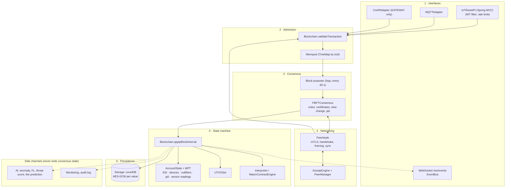
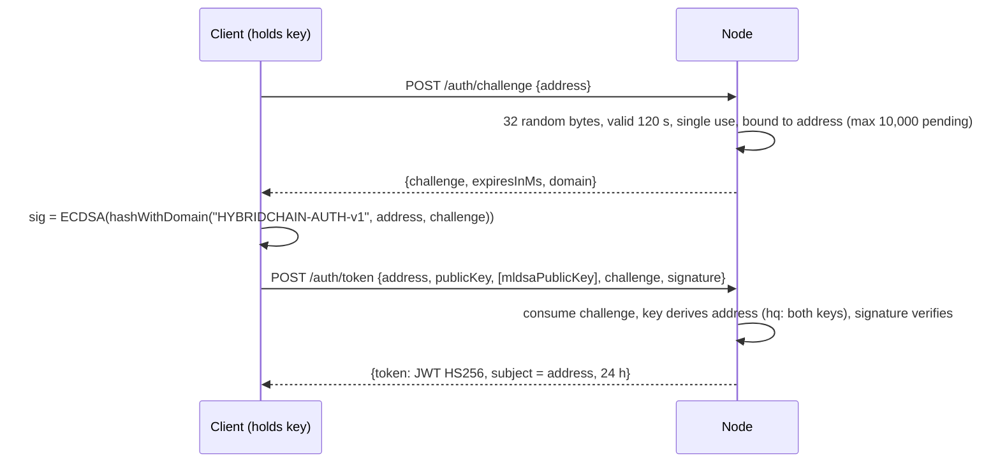
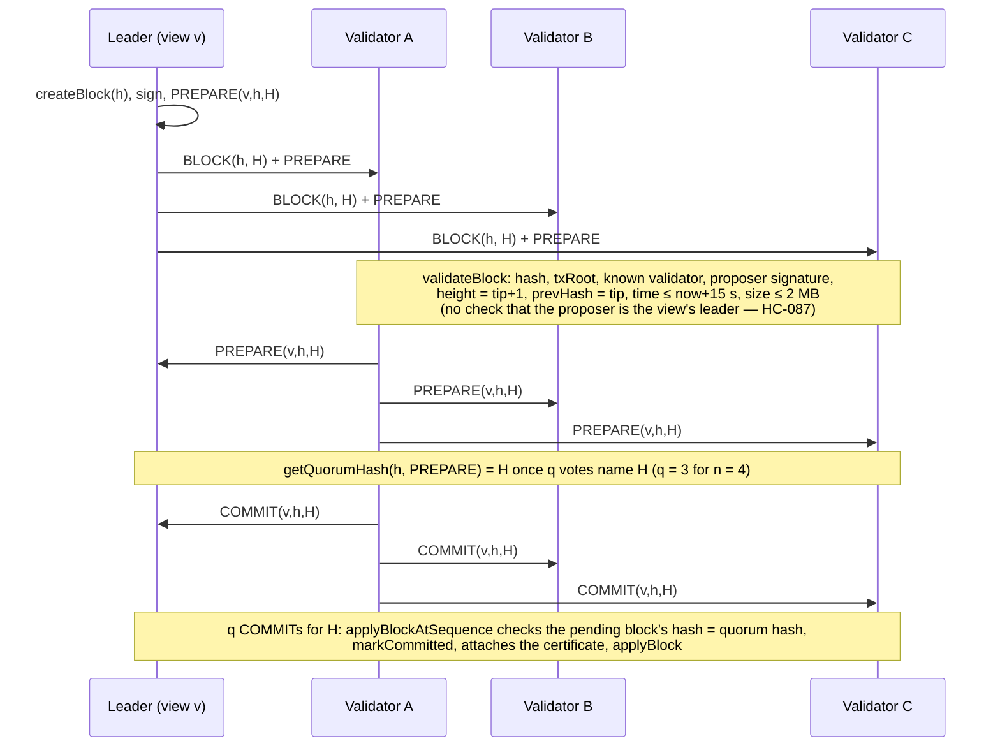
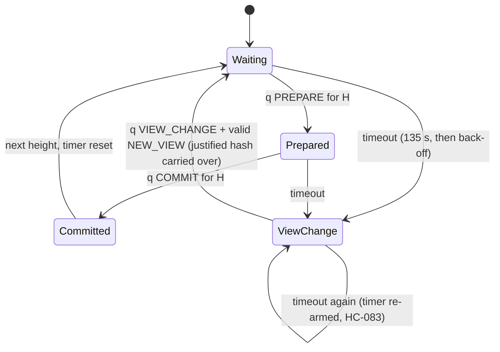

# HybridChain — Architecture Deep Dive and Rating

*Written 2026-10-24 against `main` at `8102e67`.*

> **Update, same day:** all six findings below (HC-087 to HC-092), plus HC-093 found while fixing
> them, are **fixed**, each with a test that failed on the old code. The scorecard is as of the
> review; the expected scores after the fixes, and the plan to raise every area, are in
> [`UPGRADE_PLAN.md`](UPGRADE_PLAN.md). Sections 6, 7, 9 and 10 describe the pre-fix behaviour where
> marked with the finding ID.

This is the "how it really works" companion to [`HYBRIDCHAIN_EXPLAINED.md`](HYBRIDCHAIN_EXPLAINED.md).
The explainer says **what** each part does. This document goes one level down: byte layouts,
exact constants, algorithms, the order of every check, the threads and locks, and where the design
is strong or weak. It ends with a scored rating.

**How facts were checked.** Every constant, byte layout and check order below was re-read in the
source for this document (file and method names are given). Statements marked *(from the
explainer)* were not re-read line by line this time. Six **new findings** came out of this pass
(HC-087 to HC-092, section 17). One of them is critical, and its core step was confirmed with a
throw-away test.

---

## Contents

1. [Rating](#1-rating)
2. [What it is, in one page](#2-what-it-is-in-one-page)
3. [Technology stack](#3-technology-stack)
4. [Architecture: layers, packages, threads and locks](#4-architecture-layers-packages-threads-and-locks)
5. [Node start-up and shutdown](#5-node-start-up-and-shutdown)
6. [Data model, byte by byte](#6-data-model-byte-by-byte)
7. [The state and the state root](#7-the-state-and-the-state-root)
8. [Transaction pipeline: from client to mempool](#8-transaction-pipeline-from-client-to-mempool)
9. [Block pipeline: proposal, voting, application](#9-block-pipeline-proposal-voting-application)
10. [Consensus (PBFT) in depth](#10-consensus-pbft-in-depth)
11. [Networking in depth](#11-networking-in-depth)
12. [Storage in depth](#12-storage-in-depth)
13. [Cryptography inventory](#13-cryptography-inventory)
14. [Economics: supply, rewards, fees](#14-economics-supply-rewards-fees)
15. [Smart contracts, IoT, identity, privacy, AI](#15-smart-contracts-iot-identity-privacy-ai)
16. [API layer](#16-api-layer)
17. [Security model and open findings](#17-security-model-and-open-findings)
18. [Testing, verification and CI](#18-testing-verification-and-ci)
19. [Corrections to the explainer](#19-corrections-to-the-explainer)
20. [Source map with sizes](#20-source-map-with-sizes)

---

## 1. Rating

### Scorecard

Scores compare HybridChain with production permissioned blockchains such as Hyperledger Fabric,
Hyperledger Besu (QBFT) and CometBFT, which would score about 9 on most lines. A 5 means "sound
ideas, real work done, not yet dependable".

| Area | Score | Why |
|---|---|---|
| **Concept and scope** | **8 / 10** | A clear, defensible niche: a permissioned BFT chain where devices are first-class (attested provisioning, device-signed telemetry, deterministic sensor reads for contracts, hybrid post-quantum accounts). Few projects combine these. |
| **Consensus correctness** | **5 / 10** | Textbook PBFT structure is there and much of it is now right: correct quorum `⌈(n+f+1)/2⌉`, commit certificates, prepared proofs in NEW_VIEW, on-chain jailing, deterministic round-robin leader. But a proposal is never checked against the view's leader, and a validator signs a PREPARE for every proposal it receives. That makes honest validators produce valid equivocation evidence against themselves (HC-087, critical). |
| **Cryptography** | **6.5 / 10** | BouncyCastle only, low-S ECDSA over full digests, domain-separated encodings almost everywhere, ML-DSA hybrid accounts bound to both keys. Weak spots: the block signature has no domain tag, the remaining ZK code is unaudited, and there is no post-quantum protection for consensus or networking. |
| **Security engineering** | **6.5 / 10** | 86 recorded findings with fixes and regression tests, fail-closed secrets, compromised-key denylist, non-root container, mTLS with a bounded handshake. Still: plain-HTTP REST API, shared CA seed and JWT secret, keys in environment variables. |
| **Determinism discipline** | **6 / 10** | Strong rules (no wall clock, local AI or local slashing in validity), canonical transaction execution order, sorted encodings. But part of the state root is Jackson-serialised JSON, so a JSON library upgrade can fork the network (HC-090). A `double` is hashed in every account. |
| **Code quality and maintainability** | **5 / 10** | Readable, heavily commented with the reason for each fix. But `Blockchain.java` is 2,007 lines (one method is about 460), several God classes, PoW leftovers in the block header, and a dormant unsafe "fast path" in consensus. |
| **Testing and verification** | **7.5 / 10** | 713 tests, 30 audit proof-of-concept tests, randomized Byzantine fault injection, a TLA+ model of leader selection, a live Docker fault-injection harness at 4 and 7 validators, CI on every push, coverage floors. Missing: load tests, long soak runs, live Byzantine nodes in the harness, multi-machine runs. |
| **Performance and scalability** | **3 / 10** | One block per 60 s, at most 2,000 transactions, the whole state rewritten as one JSON blob per block, a thread per peer connection, O(n²) all-to-all voting. Never load-tested. Fine for a pilot of tens of devices per second, not beyond. |
| **Operability** | **5 / 10** | Docker image, key generation, rotation runbook, Prometheus metrics, health/time endpoints, CI and Dependabot. Missing: TLS for the API, dashboards and alerts, backup/restore, upgrade tooling, crash-safe storage (HC-089). |
| **Documentation** | **7.5 / 10** | Explainer, audit reports, design notes (upgrades, key provider, CA model), gap and upgrade audits, runbooks. A few stale facts (section 19). |
| **Production readiness overall** | **3 / 10** | A research-grade pilot. It should not hold real value or personal data until HC-087 is fixed, the API has TLS, a multi-machine test has passed and an external audit has been done. |

### Overall: **5.5 / 10** — a serious, well-tested research prototype

For a single-author project this is substantial work: about 21,000 lines of node code and about
21,000 lines of tests, plus formal and live verification that many commercial prototypes skip. The
gap to production is not in features. It is in a small number of deep correctness issues
(consensus voting rules, crash safety, JSON in the state root), performance, and operations.

### Top strengths

1. **A verification culture.** Each finding has an ID, a reason in the code and a test that fails on the old code. Live chaos testing found five protocol bugs (HC-080 to HC-084) that unit tests had not.
2. **Determinism rules written down and enforced**, for example "AI is advisory", "only on-chain jail counts" and "sensor reads come from chain state".
3. **Hybrid post-quantum accounts done properly** (`hq` addresses commit to both keys, HC-079), not just "also attach a Dilithium signature".
4. **Device trust chain:** manufacturer attestation, device consent to activation, device-signed readings with a time window, PUF proofs bound to the transaction.
5. **Fail-closed configuration:** no development secrets outside DEBUG, published keys refused.

### Top risks (in order)

1. **HC-087:** a single faulty validator can get honest validators jailed. Under ordinary network delay the protocol can also make honest validators sign conflicting votes by itself.
2. **HC-089:** a crash between storage writes can leave a node whose tip and state disagree.
3. **HC-090:** a Jackson upgrade (Spring Boot 4 moves to Jackson 3) can change state roots.
4. **The REST API runs over plain HTTP.**
5. **No performance data at all.**

---

## 2. What it is, in one page

HybridChain is a **permissioned Byzantine-fault-tolerant blockchain for IoT**, written in Java.

- A fixed set of **validators** (at least 4) runs **PBFT**. Blocks are final as soon as they commit; there are no forks to wait out.
- **Accounts** hold a native coin (21 million maximum, no decimals) and user-defined **tokens**. A Bitcoin-style **UTXO** set exists alongside them.
- **Devices** are on-chain objects with a lifecycle: provisioned by a trusted manufacturer, activated by an owner with the device's consent, then suspended, resumed, revoked or given firmware updates.
- **Telemetry** (sensor readings) is accepted only when it is device-authenticated, and the latest reading of each device is in the state root. Contracts read sensors from there, never from local hardware.
- **Contracts** run on a small 64-bit stack VM or on WebAssembly (Chicory), both metered by deterministic gas.
- **Identity:** DIDs and verifiable credentials. **Privacy:** an ownership proof (Schnorr) and private data collections. **AI:** federated learning, anomaly detection and fee prediction, all strictly advisory.
- **Interfaces:** REST and WebSocket (Spring Boot), MQTT, and CoAP (gateway role only).

The name "hybrid" covers three things: account model plus UTXO, classical plus post-quantum signatures, and on-chain plus off-chain (AI, private data).

---

## 3. Technology stack

| Concern | Choice | Version (pom, 2026-10-24) |
|---|---|---|
| Language / runtime | Java | 17 (Temurin in Docker and CI) |
| Build | Maven | plugins: compiler 3.16.0, surefire 3.6.0, JaCoCo 0.8.15 |
| Web / REST / WebSocket / security | Spring Boot | **3.5.16** (out of free support since June 2026; see `UPGRADE_AUDIT.md` U1) |
| Embedded server | Tomcat | 10.1.61 (pinned override) |
| JSON | Jackson | 2.22.4 (also part of consensus, see HC-090) |
| Cryptography | BouncyCastle | bcprov/bcpkix 1.86 (secp256k1, ML-DSA, X.509) |
| Storage | LevelDB | JNI 1.8 with pure-Java fallback (iq80 0.12) |
| WebAssembly | Chicory | 1.0.0 (pinned: consensus-critical) |
| CoAP | Eclipse Californium | 3.14.0 |
| MQTT | Eclipse Paho v3 | 1.2.5 |
| JWT | jjwt | 0.13.0 |
| Metrics | Micrometer + Prometheus registry | managed by Spring Boot |
| Tests | JUnit 5, AssertJ, Awaitility, Mockito, EqualsVerifier | |
| Analysis | JaCoCo floors, SpotBugs + FindSecBugs, PIT, Error Prone, CycloneDX | |
| Live testing | Docker, pumba (netem), libfaketime, Python checker | `harness/fault-injection/` |
| CI | GitHub Actions + Dependabot | `.github/` |

---

## 4. Architecture: layers, packages, threads and locks

### 4.1 Layers



**The one rule that holds the design together:** only layer 5, entered through a quorum-certified
block, changes consensus state. Everything in "side channels" reads accepted blocks and must not
feed back into validity. Several of the worst historical bugs (HC-019, HC-026, HC-077, HC-082)
broke exactly this rule.

### 4.2 Package map

| Package | Lines | Role |
|---|---|---|
| `com.hybrid` (`App`) | 311 | Process entry: wiring, schedulers, shutdown hook |
| `blockchain` (root) | ≈ 9,900 | Core: `Blockchain`, `Block`, `Transaction`, `AccountState`, `MerklePatriciaTrie`, `Storage`, `Mempool`, `PeerNode`, VM, fees, tokens, UTXO |
| `blockchain.api` | ≈ 2,300 | REST, JWT, login challenges, WebSocket event bus, MQTT, CoAP |
| `blockchain.security` | ≈ 1,800 | CA and TLS, Spring Security, rate limits, ML-DSA, PUF, multisig, compromised-key list, simulated HSM |
| `blockchain.consensus` | ≈ 1,180 | `PBFTConsensus` |
| `blockchain.ai` | ≈ 1,170 | Federated learning, differential privacy, anomaly detector, threat scorer, contract auditor |
| `blockchain.lifecycle` | ≈ 1,060 | Device lifecycle, device-signed readings, sensor IDs |
| `blockchain.privacy` | ≈ 1,030 | ZK ownership/equality proofs, private data collections |
| `blockchain.identity` | ≈ 850 | DIDs, SSI manager, verifiable credentials |
| `blockchain.monitoring` | ≈ 700 | Metrics, Prometheus bridge |
| `blockchain.p2p` | ≈ 460 | `P2PMessage`, `GossipEngine`, `PeerManager` |
| others | | `audit` (logger), `reputation`, `governance` (unwired), `tools` (keygen) |

Total: **91 source files, 21,439 lines.** Tests: 175 files, 20,991 lines.

### 4.3 Threads

| Thread / pool | Created in | What runs there |
|---|---|---|
| `main` | `App.main` | Start-up, then joins Spring |
| Proposer (single-thread scheduler) | `App.startBlockProposer` | Every `TARGET_BLOCK_TIME_MS` = 60 s: if leader, build, sign and broadcast a block |
| Peer-list broadcaster (single-thread scheduler) | `App` | Every 30 s: `broadcastPeerList()` (every node, HC-084) |
| `PeerNode.executor` (**cached** pool) | `PeerNode` | Accept loop, one thread per connection (blocking reads), outbound dials |
| `PeerNode.peerSyncScheduler` | `PeerNode` | Seed redial (10 s, HC-080), mesh dialling (30 s, HC-084), sync |
| PBFT view-change timer | `PBFTConsensus.resetTimer` | Timeout → `triggerViewChange()` |
| Tomcat worker pool | Spring Boot | REST requests |
| Californium / Paho threads | adapters | CoAP and MQTT I/O |

The connection pool is unbounded (`newCachedThreadPool`). Its size is bounded indirectly by
`MAX_PEERS = 50`, `MAX_CONN_PER_IP = 3` and `MAX_PENDING_HANDSHAKES = 16`.

### 4.4 Locks

| Lock | Protects | Notes |
|---|---|---|
| `Blockchain.lock` (`ReentrantReadWriteLock`) | chain, state, UTXO | `applyBlock` takes the **write** lock for the whole block; `validateBlock` takes the read lock for the tip check |
| `IoTRestAPI.blockchainLock` | REST reads vs. admin actions | A **second** lock around the same objects; REST reads use it, block application does not |
| `Mempool` read/write lock | the pool | Compound operations (replace, evict) under the write lock |
| `PeerNode.sendMessage` (`synchronized`) | all socket writes | One lock for **every** peer: a slow peer delays sends to all others |
| `MerklePatriciaTrie.lock` | trie nodes | |

Two locks guard the same state (`Blockchain.lock` and `IoTRestAPI.blockchainLock`), and the global
send lock serialises all network output. Both are throughput limits, and the second is also a
liveness risk under a slow peer.

---

## 5. Node start-up and shutdown

`com.hybrid.App.main`, in order (verified in `App.java`):

1. Read `NODE_PRIVATE_KEY`, derive the public key and the address (`hb` + 40 hex characters). Outside DEBUG, keys in `security/CompromisedKeys` are refused (O-3).
2. Parse `VALIDATOR_PUBKEYS` into `address → public key` (PBFT needs at least 4).
3. `new CertificateAuthority(Config.requireNetworkCaSeed())`: every node derives the **same** CA key pair from the shared seed.
4. Generate a fresh **P-256** TLS key pair for this run and issue it a certificate from that CA.
5. `new PBFTConsensus(validators, nodeId, privKey)`, with timeout `defaultTimeoutMs()` = `max(15 000, 2·60 000 + 15 000)` = **135 s**.
6. `new Storage(STORAGE_PATH, STORAGE_AES_KEY)`, a LevelDB with AES-GCM values.
7. `Blockchain` or `PrunedBlockchain` (when `MAX_BLOCKS > 0`), with `new Mempool(10 000)`.
8. `blockchain.init()`: resume from `chain:tip`, or fast-sync from a verified checkpoint, or create the deterministic genesis block (timestamp `1 767 225 600 000` ms = 2026-01-01 00:00 UTC).
9. `new PeerNode(P2P_PORT, …)`, start listening, connect the PBFT messenger.
10. `syncJailedValidators()`: load the on-chain jail list into PBFT.
11. Register the **evidence listener**: on a detected double vote, build and submit an `EQUIVOCATION_EVIDENCE` transaction (but see HC-088).
12. If `SEED_PEER` is set, call `maintainSeedConnection(host, port, 10 000)`: redial while there are no peers.
13. `maintainMesh(30 000)`: dial discovered peers. Peer-list broadcast every 30 s.
14. Start the block proposer (section 9.1).
15. Start Spring Boot (`IoTRestAPI`). If it fails, `System.exit(1)` (HC-009).

**Shutdown hook:** stop the proposer and schedulers, the P2P node and consensus, then close storage.

---

## 6. Data model, byte by byte

All integers are big-endian (`DataOutputStream`). "Hash" means SHA-256 (`Crypto.hash`).

### 6.1 Block (`Block.java`)

**Canonical encoding** (`serializeCanonical`), which is what is hashed and signed:

| # | Field | Encoding |
|---|---|---|
| 1 | `index` | int32 |
| 2 | `timestamp` | int64 (ms) |
| 3 | `prevHash` | int32 length + bytes (hex-decoded, 32) |
| 4 | `nonce` | int64 (PoW leftover, 0) |
| 5 | `difficulty` | int32 (PoW leftover, node-local value) |
| 6 | `stateRoot` | int32 length + bytes |
| 7 | `txRoot` | int32 length + bytes |

- `hash = hex(SHA-256(canonical))`.
- **Proposer signature** = `ECDSA_sign(SHA-256(canonical))`, which is the same digest as the hash. **No domain tag, and the proposer id is not covered** (`Block.DOMAIN_PREFIX = "BLOCK\0"` exists but is unused). See HC-091.
- `txRoot` = Merkle root (`MerkleTree.computeRoot`) over `SHA-256(tx.serializeCanonical())` per transaction, or 32 zero bytes for an empty block.
- **Not in the hash:** `validatorId`, `signature`, `commitCertificate` (a list of `{validatorId, view, signature}` COMMIT votes), and the transactions themselves (covered only through `txRoot`).

### 6.2 Transaction (`Transaction.java`)

**Canonical encoding:**

| # | Field | Encoding |
|---|---|---|
| 1 | `version` | int32 = 1 |
| 2 | `type` | int32 = **enum ordinal** (append-only enum, see 6.3) |
| 3 | `networkId` | int32 (default 101) |
| 4 | `nonce` | int64 |
| 5 | `timestamp` | int64 |
| 6 | `validUntilBlock` | int64 (0 = no expiry) |
| 7 | `from` | length-prefixed UTF-8 string |
| 8 | `to` | length-prefixed UTF-8 string |
| 9 | `amount` | int64 |
| 10 | `fee` | int64 |
| 11 | `data` | int32 length + bytes |
| 12 | `inputs` | int32 count, then per input: txid string + int32 index |
| 13 | `outputs` | int32 count, then per output: address string + int64 amount |

- **Signed digest** = `SHA-256("TX\0" ‖ canonical)`, ECDSA secp256k1, low-S, 64-byte `r‖s`.
- **ML-DSA** signs the same digest (`QuantumResistantCrypto.signDilithium`).
- **txid** = `hex(SHA-256(canonical))`, computed locally and never taken from the wire (HC-029). It does not cover the signature, so re-encoding a signature cannot change a txid.
- `pubKey` (33-byte compressed), `signature`, `dilithiumPublicKey` (X.509), `dilithiumSignature` travel next to the encoding, outside it.

**Verification** (`Transaction.verify`):
1. `hq` sender: `verifyHybridBound()`. The address must equal `"hq" ‖ hex(hashWithDomain("HYBRIDCHAIN-ADDR-HYBRID-v1", ecPub, mldsaPub)[0..20])`, and **both** signatures must verify.
2. `hb` sender: `deriveAddress(pubKey) == from`, ECDSA verifies, and if `REQUIRE_QUANTUM_SIG` (default **true**) the ML-DSA signature verifies too. The ML-DSA key is not bound to an `hb` account, so this adds no real post-quantum protection there (HC-079).

### 6.3 Transaction types (ordinals are consensus)

| Ordinal | Type | Ordinal | Type |
|---|---|---|---|
| 0 | `ACCOUNT` | 8 | `TOKEN_REGISTER` |
| 1 | `UTXO` | 9 | `TOKEN_MINT` |
| 2 | `CONTRACT` | 10 | `TOKEN_BURN` |
| 3 | `IOT_MANAGEMENT` | 11 | `FEDERATED_UPDATE` |
| 4 | `MINT` | 12 | `FEDERATED_COMMIT` |
| 5 | `BURN` | 13 | `PRIVATE_TRANSFER` (disabled, O-6; kept for numbering) |
| 6 | `TOKEN_TRANSFER` | 14 | `TELEMETRY_BATCH` |
| 7 | `TELEMETRY` | 15 | `EQUIVOCATION_EVIDENCE` |

### 6.4 Addresses

| Kind | Formula | Example length |
|---|---|---|
| Classical | `"hb" ‖ hex(SHA-256(compressed secp256k1 key)[0..20])` | 42 characters |
| Hybrid | `"hq" ‖ hex(hashWithDomain("HYBRIDCHAIN-ADDR-HYBRID-v1", ecPub, mldsaPub)[0..20])` | 42 characters |

Hex never contains `q`, so the two kinds can't collide. There is no checksum, so a mistyped
address is a valid, different address.

---

## 7. The state and the state root

### 7.1 Account encoding in the trie (`AccountState.serializeAccount`)

Each account is stored in a **secure Merkle-Patricia trie** (`MerklePatriciaTrie`): the key is
`SHA-256(address)` split into nibbles, as in Ethereum, with leaf, extension and branch nodes. Value
layout:

| # | Field | Encoding |
|---|---|---|
| 1 | balance | int64 |
| 2 | token balances | int32 count, then sorted by id: length-prefixed id + int64 (zero balances omitted) |
| 3 | ZK commitment | int32 length + bytes |
| 4 | ABI | int32 length + bytes |
| 5 | nonce | int64 |
| 6 | reputation | **IEEE-754 double** |
| 7 | contract storage root | int32 length + bytes (its own trie) |
| 8 | code | int32 length + bytes |
| 9 | capabilities | int32 count, then sorted by (type, deviceId): int32 type ordinal + int64 deviceId |

A `double` in a consensus hash is deterministic on Java 17+, where all floating point is strict.
It stays fragile, though: any change in the order of operations that update it changes roots.

### 7.2 The state root (`AccountState.calculateStateRoot`)

```
accountRoot = MPT root (32 bytes)
ssiHash     = SHA-256( Jackson JSON of ssiManager.toJSON(),        keys sorted )
lcHash      = SHA-256( Jackson JSON of lifecycleManager.toJSON(),  keys sorted )
nulHash     = SHA-256( Jackson JSON of sorted spent-nullifier list )
extra[]     = [ SHA-256(JSON of sorted jailed validators) ]                 only if non-empty  (O-5)
              [ SHA-256("HYBRIDCHAIN-SENSOR-READINGS-v1\0" ‖ (int64 id, int64 value)*) ]
                                                                            only if non-empty  (HC-058)
stateRoot   = hex( SHA-256( accountRoot ‖ ssiHash ‖ lcHash ‖ nulHash ‖ extra... ) )
```

The two optional parts join only when non-empty, so roots of older states did not change when
they were added. That's a good migration technique. The weak point is that **three of the parts
are Jackson output**: their bytes depend on Jackson's serialisation of maps, numbers and strings
(HC-090).

### 7.3 What lives where

| Data | Where | In state root? |
|---|---|---|
| Balances, nonces, tokens, code, contract storage, capabilities | MPT accounts | yes |
| DIDs and credentials | `SSIManager` | yes (JSON) |
| Devices (owner, keys, firmware history, status) | `DeviceLifecycleManager` | yes (JSON) |
| Spent nullifiers | set | yes (JSON) |
| Jailed validators | set | yes, once non-empty |
| Latest sensor reading per device | sorted map | yes, once non-empty |
| UTXO set | `UTXOSet` | no (its hash goes into checkpoints, HC-035) |
| Base fee, total minted | storage meta | no (consensus-relevant, restored on revert, HC-022) |
| Receipts, address index, telemetry history | storage | no |

---

## 8. Transaction pipeline: from client to mempool

### 8.1 Entry points

| Entry | Who | Auth |
|---|---|---|
| `POST /api/v1/transactions/submit-signed` | any client | JWT whose subject equals `tx.from`, obtained by challenge login (HC-085) |
| CoAP `/tx` | devices, **only on `NODE_ROLE=GATEWAY`** | the transaction signature, per-sender rate limit |
| MQTT `blockchain/iot/<device>/telemetry`, `.../mgmt` | devices, owners | device-signed reading, or an owner-signed transaction (HC-064) |
| P2P `TRANSACTION` gossip | peers | the transaction signature |

### 8.2 Challenge login (HC-085)



### 8.3 Validation (`Blockchain.validateTransaction`, about 460 lines)

Common checks first, in this order: MINT only from the system; `hq` only after its activation
height; signature (`verify`); `networkId`; destination present where needed; no negative amount or
fee; not expired (`validUntilBlock`). Then **per type**:

| Type | Main checks |
|---|---|
| `ACCOUNT` | overflow-safe `amount + fee`, balance, nonce = state nonce + 1 (or within `MAX_NONCE_GAP = 100` for the mempool), fee ≥ base fee |
| `UTXO` | signed by the owner of every input, no duplicate inputs, inputs unspent, outputs positive and addressed, inputs ≥ outputs + fee |
| `CONTRACT` | contracts enabled, static audit (`SmartContractAuditor`) unless bypassed in tests, nonce, funds |
| `IOT_MANAGEMENT`, `FEDERATED_*` | nonce, fee; action rules are applied in the state transition |
| `MINT` | system-initiated, supply cap not reached, amount = scheduled reward |
| `BURN` | sender, nonce, funds |
| `TOKEN_*` | sender/receiver, token id, token balance, native balance for the fee, nonce |
| `TELEMETRY` | sender, payload, device authentication (four paths, section 15.2), device and owner ACTIVE, fee, nonce |
| `TELEMETRY_BATCH` | gateway sender, non-empty, fee (readings are not trusted for AI) |
| `PRIVATE_TRANSFER` | always rejected (O-6) |
| `EQUIVOCATION_EVIDENCE` | both votes signed by the accused validator, same phase/view/height, different hashes |

### 8.4 Mempool (`Mempool.java`)

- Storage: a `TreeMap<txid, Transaction>`, so iteration order is deterministic. Maximum **10,000**.
- **Replacement:** same sender and nonce replaces only with a higher fee. When full, a lower-value transaction can be evicted for a better one.
- **Selection for a block** (`getReadyTransactions`): group by sender and sort each sender's transactions by nonce. Start each sender's chain at `state nonce + 1`, then repeatedly take the best candidate by **fee per byte** (`fee / canonical length`) from a priority queue, offering the sender's next nonce after each pick. System transactions are always ready.

---

## 9. Block pipeline: proposal, voting, application

### 9.1 Proposal (`App.startBlockProposer`, every 60 s)

```
if paused: skip
if PBFT has a justified (re-proposed) hash for height+1: skip           // O-1, NEW_VIEW
if this node == pbft.getCurrentLeader():                                // round-robin, HC-082
    block = blockchain.createBlock(nodeId, 2000)
    block.signature = ECDSA(SHA-256(canonical));  block.validatorId = nodeId
    sign PREPARE(view, height, hash); record it; broadcast it
    setPendingBlock(height, block); broadcastBlock(block)
```

**`createBlock`:** take ready transactions from the mempool, add the MINT (scheduled reward to
the proposer), simulate every transaction on a cloned state, and **drop** those that fail (honest
proposers never include an inapplicable transaction, HC-017). Then compute `txRoot` and the
post-state root, and set `timestamp > parent`.

**Note:** the proposer runs on a fixed 60-second rate, independently of whether the previous
proposal has committed. If height *h* hasn't committed 60 s later, the same leader proposes a
**second, different** block for *h* in the same view (part of HC-087).

### 9.2 Normal-case message flow



Every vote is sent to every validator: **O(n²) messages per block**, about 2·n² (PREPARE and COMMIT).

### 9.3 Application (`Blockchain.applyBlock` → `applyBlockInternal`)

`applyBlock` takes the write lock. If `index = tip + 1` it applies the block; if `index = tip` it
goes to fork handling; otherwise it ignores the block. `applyBlockInternal`, in exact order:

1. `validateBlock` (the proposal checks in 9.2).
2. `prevHash == tip.hash`; `timestamp ≤ now + 15 s`; `timestamp > parent.timestamp`; `txRoot` recomputed.
3. The proposer is a known validator, and `consensus.verifyBlock`: proposer signature **and** (committed locally **or** a valid commit certificate **or** a single-validator network).
4. **Supply rule:** at most one MINT, and it pays `validatorId` (HC-016).
5. **Canonical execution order:** MINT first, then by `from`, then by `nonce`. The order of transactions in the block doesn't matter for execution.
6. **Nonce sequence check** over that order (each sender: state nonce + 1, + 2, …).
7. `validateTransaction(tx, skipNonce=true)` for every transaction, with **block time** as the validation clock (HC-013).
8. **Snapshot for rollback:** clone the state and UTXO set, save `totalMinted`, clear the pending-write buffer, begin the token-registry block.
9. For each transaction: `applyTransactionToState`.
   - `RevertException` → receipt `REVERTED`; fee and nonce are still charged.
   - `ChargedFailureException` → `FAILED`; charged.
   - Any other exception → **the whole block is invalid**.
   - Receipts and indexes go into the deferred-write buffer.
10. Credit the **total fees** to the proposer (section 14.3).
11. Deferred actuator actions of the block 6 blocks back become executable.
12. **State root check:** recomputed root ≠ `block.stateRoot` → reject.
13. Accept: append to the chain, commit the token registry, run the deferred writes.
14. Advisory anomaly detection (off the consensus path, HC-026).
15. Evict the block's transactions from the mempool.
16. Next base fee (section 14.3); fee history.
17. Persist: `totalMinted`, `saveBlock` (block, `height:n`, **`chain:tip` with a synchronous write**), `saveUTXO`, `saveState`, `saveSnapshot` (16 kept). See HC-089.
18. Pruning (`PrunedBlockchain`), metrics, audit log.
19. Every 1,000 blocks, broadcast a checkpoint signature request.
20. Publish the `blocks` event; PoW difficulty adjustment every 10 blocks (a leftover, HC-091).

Any exception in steps 9–20 restores the snapshot, clears the buffered writes and rolls back the
token registry. A rejected block leaves no trace (S1-01, HC-024).

### 9.4 Fork handling

At `index == tip`, a competing block wins if its hash is **lexicographically greater**. It's
checked first (hash, parent, signature, certificate, HC-021). Then the tip is reverted from the
snapshot (restoring `totalMinted` and the base fee, HC-022) and the competitor applied. With
correct PBFT, two certified blocks at one height can't exist, so this is a safety net for a broken
assumption.

---

## 10. Consensus (PBFT) in depth

### 10.1 Mathematics

- `f = ⌊(n − 1) / 3⌋`, `q = ⌈(n + f + 1) / 2⌉` (`quorumSize`, HC-002).
- **Why `q`:** two quorums overlap in at least `2q − n` validators. Safety needs at least one honest validator in every overlap: `2q − n ≥ f + 1`. The common shortcut `2f + 1` is equal to this only when `n = 3f + 1`. For n = 5 it gives 3, and two 3-sets can overlap in one, possibly faulty, node.

| n | f | q |
|---|---|---|
| 4 | 1 | 3 |
| 5 | 1 | 4 |
| 7 | 2 | 5 |
| 10 | 3 | 7 |

### 10.2 Vote format (`PBFTConsensus.PBFTMessage`)

```
digest = SHA-256( "HYBRIDCHAIN-PBFT-v2\0"
                  ‖ lenstr(phase) ‖ int64 view ‖ int64 seq ‖ lenstr(blockHash) ‖ lenstr(validatorId) )
lenstr(s) = int32 length (−1 for null) ‖ UTF-8 bytes
```

Before HC-066 this was plain string concatenation, where (view 1, seq 23) and (view 12, seq 3)
gave the same bytes. Incoming votes are verified against the **local** view number: a vote from
another view simply fails verification.

### 10.3 Phases and rules

| Phase | Trigger | Rule |
|---|---|---|
| PRE-PREPARE | the leader's BLOCK message | (no separate message; the block is the proposal) |
| PREPARE | each validator, on each BLOCK it accepts | signed PREPARE(v, h, H) broadcast to all |
| COMMIT | `getQuorumHash(h, PREPARE)` returns H | signed COMMIT(v, h, H) |
| COMMITTED | `getQuorumHash(h, COMMIT)` returns H | apply the pending block **only if** its hash is H (S7-01) |

`getQuorumHash` counts votes **per hash**. An old version counted distinct voters, so votes for
different blocks added up to a "quorum" (S7-01).

### 10.4 Leader election (HC-082)

```
eligible = sort( validators − jailed )
leader(v) = eligible[ v mod |eligible| ]
```

This uses only the view number, the configured set and the on-chain jail list, so all nodes at the
same height agree. Reputation-weighted election was removed after the live harness showed three
survivors of a leader crash picking three different leaders.

### 10.5 Timer and view change (HC-083)

- Timeout `T = max(15 s, 2 × block time + 15 s)` = **135 s**, with back-off `T · 2^min(k, 3)` after *k* consecutive timeouts: 135 s, 270 s, 540 s, then 1,080 s.
- The timer is re-armed after every timeout and every view change, and reset on commit. Before HC-083 it only restarted on commit, so after one failed view change no node ever timed out again.
- **VIEW_CHANGE(v+1)** carries the sender's **prepared proof**: the block it saw prepared, with its PREPARE signatures.
- With `q` view changes, the leader of v+1 sends **NEW_VIEW**: the view changes plus a re-proposal of the prepared block with the highest view (`choosePrepared`), or nothing.
- Every node **re-derives** that choice and rejects a NEW_VIEW that proposes anything else (`acceptNewView`). The re-proposed hash becomes the **justified hash** for that height, and the proposer must not propose anything else there.



### 10.6 Finality and commit certificates (HC-046)

`verifyCommitCertificate(block)`:
- the certificate has at most `4n` entries;
- per entry: a known validator, not on the on-chain jail list, not counted twice, and a valid COMMIT signature over (view, index, hash);
- at least `q` valid entries.

A syncing node therefore needs no trust in whoever sent it the block.

### 10.7 Equivocation and jailing (O-5)

Two signed votes by one validator with the same phase, view and height but different hashes are
**evidence**. `verifyEvidence` checks both signatures. An `EQUIVOCATION_EVIDENCE` transaction puts
the validator on the **on-chain jail list**. A jailed validator can't lead, its votes don't count,
and its certificate entries are ignored. Locally observed misbehaviour is logged only (HC-019,
O-5).

### 10.8 Dormant fast path

`AsyncCommitPath` (RWA-BFT, Sensors 2025) lets a validator skip PREPARE when all members of a
reputation-based committee committed the previous height in time. It's **off** (`asyncEnabled =
false`, no caller turns it on). It shouldn't be turned on: committing without a prepared proof
breaks the NEW_VIEW guarantee, and the committee uses node-local reputation and the wall clock
(HC-092).

### 10.9 Alternative engine

`PoAConsensus`, a round-robin proof of authority, used in tests. It has its own block signing with
a `BLOCK\0` domain tag.

---

## 11. Networking in depth

### 11.1 Transport

- **TLS with mutual authentication** (`SSLUtils`, `CertificateAuthority`). Each node presents a P-256 certificate issued by the network CA. The CA key comes from `NETWORK_CA_SEED`, which **every node holds**, so every node operator can issue certificates (see `docs/design/CA_TRUST_MODEL.md`).
- No trust-all fallback (HC-006). Certificates are verified, but the node identity is proven by the handshake, not by the certificate.

### 11.2 Handshake (protocol version 2)

| Step | Direction | Bytes |
|---|---|---|
| HELLO | both | int32 type, int32 length = 44, int32 version = 2, int32 networkId, int32 rule flags (bit 0 = `REQUIRE_QUANTUM_SIG`), 32-byte nonce |
| CHALLENGE | both | int32 type, int32 length = **97 exactly**, 33-byte compressed key, 64-byte signature over `handshakeDigest(peerNonce, ownAddress, networkId)` (domain `HC-P2P-HANDSHAKE-v2`) |
| HANDSHAKE_OK | inbound → outbound | int32 type, int32 0 |

Then the node checks the IP ban list, that the key is in the validator set (HC-011), the global
and per-IP limits, and `MAX_PENDING_HANDSHAKES = 16` with a 10 s timeout (HC-012). The handshake is
**not bound to the TLS session** (no channel binding). That's acceptable while only CA holders can
terminate TLS, but worth noting.

### 11.3 Framing and messages

- Each frame: int32 length (at most 10 MB) followed by a JSON `P2PMessage`.
- `P2PMessage`: `senderId`, `type`, `payload`, `senderPubKey`, `signature`, `timestamp`. The signature covers `hashWithDomain("HC-P2P-MSG-v1", senderId, type, payload)` (HC-040). `verifyOrigin` checks that the key derives `senderId` and that the signature verifies (HC-044).
- Types: `TRANSACTION`, `BLOCK`, `CONSENSUS`, `PEER_DISCOVERY`, `PING`/`PONG`, `REQUEST_BLOCKS`, `BLOCKS_RESPONSE`, `CHECKPOINT`, `GOSSIP`.

### 11.4 Gossip

- **Message id** = `hash(sender ‖ type ‖ payload)`, or the transaction hash for `TRANSACTION`. It has no timestamp, which is why HC-084 added one to peer lists.
- **Deduplication:** LRU of 1,000 ids. The id is checked before the signature but recorded only after verification, so a forged copy can't pre-empt the real one.
- **Relay:** to `fanout = 3` random peers with score ≥ 30, excluding the sender.
- **Peer scores:** penalties for bad blocks (−10), bad transactions (−1), rejected sync blocks (−5). Below 10, the peer's IP is banned. Slashing state has an expiry.

### 11.5 Discovery and topology (HC-080, HC-084)

- Every node broadcasts its peer list every 30 s. The list includes its own entry with height, **listening port** and a timestamp, plus peers with a known listening port.
- Discovered peers are **candidates** only (at most 64). `maintainMesh` dials up to 8 unconnected candidates every 30 s, and the handshake decides who is admitted.
- `maintainSeedConnection` redials the seed every 10 s while the node has no peers.
- Result: a mesh rather than a star, so losing the seed (which was also the leader in the live test) no longer partitions the network.

### 11.6 Sync

- Heights come from the peers' own peer-list entries (HC-068); they're hints only.
- A node behind asks the highest peer with `REQUEST_BLOCKS(fromHeight)`. At most **50** blocks per request and response (HC-067).
- Every synced block goes through `applyBlock`, so it needs a valid commit certificate and full re-execution. A bad block costs the sender 5 points and stops the batch.

### 11.7 Checkpoints

Every 1,000 blocks: content (height, block hash, state root, UTXO hash, timestamp), hash with
`HYBRIDCHAIN-CHECKPOINT-v2`. Validators sign only if the checkpoint matches **their own** chain
(HC-043). The requester merges only verified signatures for identical content and stores the
checkpoint once it has `q`. Fast sync from a checkpoint re-verifies the signatures, the block, the
state root and the UTXO root (HC-069, HC-070).

### 11.8 Limits

| Limit | Value |
|---|---|
| Peers | 50 (`MAX_PEERS`) |
| Connections per IP | 3 (`MAX_CONN_PER_IP`, a problem behind NAT) |
| Pending handshakes | 16 |
| Handshake timeout | 10 s |
| Frame size | 10 MB |
| Discovered candidates | 64 |
| Sync batch | 50 blocks |

---

## 12. Storage in depth

- **Engine:** LevelDB through `leveldbjni` 1.8, falling back to the pure-Java iq80 port when the native library can't load (for example on ARM64).
- **Encryption:** every value is `IV(12 random bytes) ‖ AES-GCM(value)`. The **record key is authenticated data** (HC-041), so a ciphertext can't be moved to another key. The AES key is `STORAGE_AES_KEY` (per node).
- **Keys are stored in plaintext:** `secureKey(k)` returns `k` unchanged, so the on-disk key space reveals, for example, which addresses are indexed (`addridx:<address>:…`).
- **Layout:**

| Key | Value |
|---|---|
| `block:<hash>` | full block with certificate (JSON) |
| `height:<n>` | block hash |
| `chain:tip` | tip hash (**synchronous** write) |
| `state:account` | **the whole state as one JSON document** |
| `utxo:set` | the whole UTXO set |
| `snapshot:<n>` | state, UTXO set, `totalMinted`, base fee (last 16) |
| `receipt:<txid>`, `tx:<txid>`, `addridx:…` | receipts and indexes |
| `checkpoint:<n>` | quorum-signed checkpoints |
| `meta:*` | `totalMinted`, base fee, difficulty, last checkpoint |

- **Write order after a block:** `meta:totalMinted` → block → `height:n` → `chain:tip` (synchronous) → UTXO set → state → snapshot. These aren't one atomic batch (HC-089).
- **Cost:** the whole state is serialised and written for every block, so the write cost per block grows with the number of accounts and devices.

---

## 13. Cryptography inventory

| Purpose | Algorithm | Detail |
|---|---|---|
| Account, validator and vote signatures | ECDSA secp256k1, HMAC-DRBG nonces (RFC 6979 style), SHA-256 | Input must be exactly a 32-byte digest (HC-040); low-S; 64-byte `r‖s` |
| Post-quantum signatures | ML-DSA (FIPS 204) | Level 3 (`generateDilithiumKeyPair(3)` in tooling) |
| Hashing | SHA-256 | `hashWithDomain(domain, parts…)` with length-prefixed parts |
| Transport | TLS, P-256 certificates | CA derived from `NETWORK_CA_SEED` |
| Storage | AES-GCM (12-byte IV) | AAD = record key |
| API tokens | JWT HS256 (jjwt 0.13) | Secret from `JWT_SECRET`; no development secret outside DEBUG (HC-052) |
| Device proofs | Schnorr ownership proof (Fiat-Shamir) on secp256k1 | Challenge bound to transaction and payload (HC-071) |

**Domain tags in use** (each one stops a signature from one context being reused in another):

| Tag | Used for |
|---|---|
| `TX\0` | transaction signatures |
| `HYBRIDCHAIN-PBFT-v2\0` | PREPARE, COMMIT, VIEW_CHANGE, NEW_VIEW votes |
| `HYBRIDCHAIN-CHECKPOINT-v2\0` | checkpoint signatures |
| `HC-P2P-MSG-v1` | every P2P message |
| `HC-P2P-HANDSHAKE-v2` | handshake proof of key possession |
| `HYBRIDCHAIN-ADDR-HYBRID-v1` | `hq` address derivation |
| `HC-HYBRID-SIG-v1` | hybrid signature helper |
| `HYBRIDCHAIN-AUTH-v1` | REST login challenge (HC-085) |
| `HC-IOT-READING-v1` | device-signed readings |
| `HC-DEVICE-ACTIVATE-v1` | device consent to activation |
| `HYBRIDCHAIN-FIRMWARE-v1\0` | manufacturer firmware signatures |
| `HC-PUF-NULLIFIER-v1` | PUF device nullifiers |
| `HYBRIDCHAIN-ZK-TELEMETRY-v1` | PUF telemetry proof binding |
| `HYBRIDCHAIN-SENSOR-ID-v1` | sensor id of a device |
| `HYBRIDCHAIN-SENSOR-READINGS-v1\0` | sensor readings in the state root |
| `HC-SSI-TRANSFER-v1`, `HC-SSI-DELEGATE-v1` | identity transfer and delegation |
| `HC-HSM-SIGN-v1` | simulated HSM |
| `HYBRIDCHAIN-ZK-PRIVATE-TRANSFER-v1` | disabled private transfer |
| **none** | **block proposer signature** (HC-091) |

---

## 14. Economics: supply, rewards, fees

### 14.1 Supply (`Tokenomics`)

- Maximum supply **21,000,000** units, **no decimals** (one unit is the smallest amount).
- Reward **50** per block, halving every **210,000** blocks, minimum 1, zero once the cap is reached.
- Exactly one MINT per block, paid to the proposer (HC-016). At 60 s blocks a halving takes about 146 days, so the cap would be approached in a few years.

### 14.2 User tokens

`TOKEN_REGISTER` (id, name, symbol, decimals, max supply; the sender becomes owner), then
`TOKEN_MINT` (owner, up to the maximum), `TOKEN_TRANSFER`, `TOKEN_BURN`. Balances live in the
account's token map, in the state root (HC-028).

### 14.3 Fees (`FeeMarket`, `applyBlockInternal`)

- "Gas" for the fee market is the **number of transactions** in the block. Target = `2000 / 2` = **1,000**.
- `next = max(1, base + base·(used − target) / target / 8)`, with a forced ±1 step when the integer division gives 0 (EIP-1559 shape, at most 1/8 change per block).
- Initial base fee 0, clamped to 1. In practice it **stays at 1** unless blocks carry more than 1,000 transactions.
- Every signed transaction pays at least the base fee (HC-033).
- **The proposer receives the full fee of every transaction.** No part is burned (the explainer says otherwise; section 19). Failed transactions still pay; the proposer is never credited a fee that was not debited (HC-017).
- Contract gas limit = `min(fee, Long.MAX/1000) × 1000` (HC-062).

---

## 15. Smart contracts, IoT, identity, privacy, AI

### 15.1 Contracts

- A **deploy** is a `CONTRACT` transaction with an empty `to`. Code starting with the WASM magic `\0asm` runs on Chicory; anything else runs on the stack VM. Maximum code size 32 KB.
- **Execution** runs on a cloned state. Success merges; revert or failure discards, but fee and nonce are still charged.
- **Stack VM** (`Interpreter`): 64-bit words, stack limit 1,024 (HC-057), opcodes and gas as listed in the explainer (for example SSTORE 5,000, SLOAD 200, CALL 700). SYSCALL 1 reads a sensor from **chain state** (HC-058); SYSCALL 2 queues an actuator command, which needs a `WRITE_ACTUATOR` capability and runs 6 blocks later.
- **WASM** (`WasmContractEngine`): 1 gas per instruction, 1,000 per 64 KiB page grown, 1 per 64 bytes of bulk copy, at most **10,000,000** gas per call. A 30 s wall-clock backstop is a safety net only (HC-059). Module cache of 64 (HC-061). Host functions: `hb_state_read`, `hb_state_write`, `hb_read_sensor`, `hb_get_gas`.
- **Can't do yet:** send coins out of a contract, hash, verify signatures; WASM can't see caller or value.

### 15.2 IoT

**Lifecycle** (`DeviceLifecycleManager`): PROVISION by a registered manufacturer (attestation over
id, model and key; a PUF nullifier for PUF devices) → ACTIVATE by the named owner **with the
device's signed consent** (`HC-DEVICE-ACTIVATE-v1`, HC-047) → SUSPEND / RESUME / REVOKE (owner) →
UPDATE_FIRMWARE (owner; "verified" only with the manufacturer's signature, otherwise reputation
×0.8, HC-074). The whole record is in the state root (HC-048).

**Telemetry authentication** (`isDeviceAuthenticated`, any one of):
1. a `DeviceReading` signed by the device's registered key (`HC-IOT-READING-v1`), timestamp within **10 minutes** (`MAX_SKEW_MS`) of the block time;
2. a PUF proof bound to (device, sender, nonce, payload) (HC-071);
3. sent by the device's own key.

A reading sent by the **owner** is stored as telemetry but never becomes the contract-visible
sensor value.

**Sensor values:** the latest authenticated reading in milli-units (`21.5` → `21500`), keyed by
`hashWithDomain("HYBRIDCHAIN-SENSOR-ID-v1", deviceId)[0..8]`. Without a reading the value is
`NO_READING = Long.MIN_VALUE`.

**Channels:**
- MQTT topics `blockchain/iot/<device>/telemetry` (a device-signed reading) and `.../mgmt` (a whole owner-signed transaction; the node never signs for a publisher, HC-064).
- CoAP `/health`, `/balance`, `/tx`, `/telemetry`, only on `NODE_ROLE=GATEWAY`.

### 15.3 Identity *(from the explainer, spot-checked)*

DIDs `did:hybrid:…` with verification keys (`SSIManager`), and verifiable credentials with ISO-8601
expiry, where an unparseable expiry counts as expired (HC-050). Transfer and delegation are
domain-signed (`HC-SSI-TRANSFER-v1`, `HC-SSI-DELEGATE-v1`). Multisig wallets and council governance
exist, but are **not wired** into transactions (GAP_ANALYSIS C1).

### 15.4 Privacy

`ZKProofSystem` keeps the Schnorr **ownership** proof and an **equality** proof; both are reviewed,
not formally proven. Range, threshold and firmware "proofs" and the eligibility gate were removed
as unsound (O-7). `PRIVATE_TRANSFER` is disabled (O-6). `PrivateDataCollection` holds encrypted
member-readable data with public hashes.

### 15.5 AI (advisory only)

| Component | Input | Output | Consensus effect |
|---|---|---|---|
| `TelemetryAnomalyDetector` | authenticated TELEMETRY of accepted blocks | z-score + ARIMA(1,1,1) alerts, `anomalies` topic | none |
| `FederatedLearningManager` | `FEDERATED_UPDATE`/`COMMIT` after acceptance | aggregated model (hash-checked, validators only) | none |
| `DPMechanism` | aggregated weights | noise, ε = 1.0 per aggregation (no cross-round accounting yet, research note M4) | none |
| `PredictiveThreatScorer` | vote signature failures | monitoring score, log warnings | none (removed from leader selection) |
| `SmartContractAuditor` | contract bytecode | deploy-time rejection | **yes**: a deterministic static rule, part of validity |
| Fee prediction | fee history | `/ai/fee-prediction` | none |

---

## 16. API layer

### 16.1 Request path

```
Tomcat → Spring Security filter chain (stateless; JwtAuthFilter) → authorisation rules
       → MVC interceptors: MDC correlation id, API rate limiter (per IP: burst 200, refill 100 per minute)
       → IoTRestAPI handler
```

A request rejected by the security chain never reaches the rate limiter, so unauthenticated
floods of write endpoints are not counted per IP.

**Authorisation rules** (`SecurityConfig`, first match wins):
1. `/api/v1/admin/**` needs authentication, and the handler also requires the `ADMIN` role.
2. `GET /health`, `/ready`, `/metrics`, `/actuator/**` are public. Spring Boot exposes only `health` from Actuator by default; `/actuator/prometheus` is not exposed.
3. Every other `GET /api/**` is public at the filter level. Handlers such as `GET /accounts/{address}` still check that the token belongs to that address.
4. `POST /account/create` (DEBUG only in the handler), `/auth/challenge` and `/auth/token` are public.
5. Every other `POST`, `PUT` and `DELETE` needs authentication.

**Per-sender limit** on `submit-signed`: 40 per minute per sender address.

**Not present:** TLS. The API is plain HTTP, so it must sit behind a TLS reverse proxy for any real
use (GAP_ANALYSIS S2).

### 16.2 Endpoint groups

As in the explainer section 18, with these changes:
- `/admin/config/update` was removed (HC-086);
- `/auth/challenge` and `/auth/token` were added (HC-085);
- `/health` now also returns the node's clock (`time`), which the clock-skew harness uses.

### 16.3 WebSocket

`/ws/events`, topics `blocks`, `transactions`, `mempool`, `contracts`, `anomalies`, `consensus`.
Per-topic filters, at most 8 keys; an event that can't be filtered isn't sent (HC-063).

---

## 17. Security model and open findings

### 17.1 Trust assumptions

| Assumption | Consequence if broken |
|---|---|
| At most `f` of `n` validators are faulty | Safety and liveness are lost |
| Every validator operator is trusted with `NETWORK_CA_SEED` | Any of them can issue TLS certificates for the network |
| Every node shares `JWT_SECRET` | Any node operator can mint API tokens for any address (API access only; transactions still need signatures) |
| Node keys in environment variables | A host compromise takes the validator key |
| Clocks within 15 s | A validator further off rejects fresh blocks or proposes unacceptable ones; the live test showed the network survives one such node |

### 17.2 New findings from this review

| ID | Severity | Status | Finding |
|---|---|---|---|
| **HC-087** | **Critical** | **Fixed** `cbfd9dc` | **Honest validators can be made to equivocate.** (1) A proposal is never checked against `selectLeader(view)`: `validateBlock` and the `BLOCK` handler accept a block from **any** validator for the next height. (2) A validator signs and records a PREPARE for **every** proposal it accepts; nothing limits it to one per (view, height). (3) `addPrepareVote` turns a second PREPARE from the same validator into equivocation evidence, including the node's own vote: a probe produced valid evidence against itself (`verifyEvidence = true`). **Attack:** one Byzantine validator sends a second validly signed block for the current height, collects every honest validator's two conflicting PREPAREs from their broadcasts, and submits `EQUIVOCATION_EVIDENCE` for each. All honest validators are jailed on-chain, and the chain halts or the attacker becomes the only eligible leader. **No attacker needed:** the proposer re-proposes height *h* every 60 s while *h* is uncommitted (view timeout 135 s), so under ordinary delay honest nodes PREPARE two blocks for *h* in one view. **Fix:** accept a proposal only from `selectLeader(view)`; sign at most one PREPARE per (view, height); don't re-propose a height while a proposal is pending in the same view; turn the "own double vote" path into an assertion. |
| HC-088 | Medium | **Fixed** `dfabf8a` | **Automatic evidence submission is rejected by default.** The evidence listener in `App` signs `EQUIVOCATION_EVIDENCE` with ECDSA only. With the default `REQUIRE_QUANTUM_SIG=true`, `Transaction.verify` requires an ML-DSA signature, so the transaction fails validation ("Could not submit evidence"). Jailing currently happens only when someone submits double-signed evidence by hand, as the harness tool does. This hides HC-087's natural trigger, so fix HC-087 **before** fixing this. |
| HC-089 | Medium | **Fixed** `68cadf0` (reproduced first) | **Not crash-safe.** After a block, `chain:tip` is written synchronously **before** the UTXO set, the state and the snapshot, as separate writes. A crash in between leaves a tip at block *N* with the state of *N − 1*; the next block's state root check then fails on that node. **Fix:** one LevelDB `WriteBatch` per block, with the tip written last; on start-up, verify the stored state's root against the tip block. |
| HC-090 | Medium | **Fixed** `2097ad6` | **JSON in the state root.** The identity registry, device registry, nullifiers and jail list enter the state root as Jackson output. A Jackson change in number, string or map formatting changes roots; Spring Boot 4 moves to **Jackson 3**. **Fix:** canonical binary encodings for these four parts behind an activation height; until then, keep Jackson pinned and add a golden state-root test that must not change on upgrades. |
| HC-091 | Low | **Fixed** `1808adf` | **Block signature without a domain tag.** The proposer signs `SHA-256(canonical)` (the block hash) directly, and the proposer id is not covered; `Block.DOMAIN_PREFIX` is dead code. No cross-protocol reuse was found (all other signed digests are domain-tagged), but this is the only exception. Fix together with removing the PoW fields (`nonce`, `difficulty`) at the next header version. |
| HC-092 | Low (dormant) | **Fixed** `3a7d13a` | **Unsafe "fast path" in consensus.** `AsyncCommitPath` lets a validator COMMIT without PREPARE, based on node-local reputation and wall-clock deadlines. It's off and nothing enables it. Remove it. |
| HC-093 | Medium | **Fixed** `621f6b1` | **A revoked device was mapped again after a restart.** `revokeDID` removed the device → DID mapping, but `SSIManager.fromMap` rebuilt it for every DID, revoked ones included. A restarted node computed a different state root (so it rejected the next block) and accepted different identity registrations. Found by the HC-090 round-trip test. |

### 17.3 Still open from earlier

GAP_ANALYSIS and UPGRADE_AUDIT list the rest. The main ones:
- REST over plain HTTP (S2);
- no multi-machine run (N1);
- validator-set changes impossible at runtime (C1);
- consensus and networking not post-quantum (C2);
- no external audit (S1);
- Spring Boot 3.5 out of free support (U1).

---

## 18. Testing, verification and CI

| Layer | What | Numbers |
|---|---|---|
| Unit and integration | JUnit 5 | **713 tests**, 0 failures; JaCoCo floors (consensus branch ≥ 0.73) |
| Audit proofs | `HybridChainAuditPoCTest` | 30 proofs, each asserting the **correct** behaviour (weekly in CI) |
| Byzantine simulation | `ByzantineFaultInjectionTest` | randomized drop, partition, delay, duplicate and pause faults plus one equivocating node; found S7-01 |
| Formal | TLA+ (`docs/formal/LeaderSelect.tla`, TLC) | leader-agreement counterexample for the old scheme; the current round-robin scheme is trivially agreeing |
| Live chaos | Docker harness (`harness/fault-injection`) | baseline, leader crash, partition, delay and loss, restart and resync, equivocation evidence, clock skew: all passed at 4 and 7 validators (the new ±30 s skew phase is not yet run live) |
| Mutation | PIT on `Crypto` | weekly |
| Static | SpotBugs + FindSecBugs, Error Prone | weekly / on demand |
| Supply chain | CycloneDX SBOM, OSV report, Dependabot | every push / weekly |

**What testing does not cover yet:**
- transaction load and long runs;
- a Byzantine **proposer** in the live harness (it would have found HC-087);
- crash injection during block persistence (HC-089);
- a golden state-root test across library versions (HC-090);
- several machines.

---

## 19. Corrections to the explainer

These statements in `HYBRIDCHAIN_EXPLAINED.md` are out of date or wrong as of this review:

| Explainer says | Actually |
|---|---|
| Block encoding has a `BLOCK\0` domain prefix | The constant exists but is unused; the block hash is plain `SHA-256(canonical)` (HC-091) |
| View-change timeout 15 s | 135 s, with back-off up to 1,080 s (HC-083) |
| Seed nodes broadcast the peer list | Every node does, every 30 s, and dials discovered peers (HC-084) |
| The base-fee part is **burned** | Nothing is burned; the proposer receives the whole fee |
| Storage keys are hashed | Keys are stored in plaintext (`secureKey` is the identity) |
| Run `…-jar-with-dependencies.jar` | That jar is not runnable; run the Spring Boot jar `target/blockchain-java-1.0-SNAPSHOT.jar` |
| Older adapters in the `iot` package; Proof of Inference | Deleted 2026-10-23 |
| 695 tests, 74.2 % line coverage | 713 tests, 75 % line / 63 % branch |
| `MIN_PEERS` "see PeerManager" | Default 1 |

---

## 20. Source map with sizes

| File | Lines | What to read it for |
|---|---|---|
| `blockchain/Blockchain.java` | 2,007 | validation (`validateTransaction`), `createBlock`, `applyBlockInternal`, forks |
| `blockchain/PeerNode.java` | ≈ 1,330 | handshake, framing, gossip handlers, PBFT messaging, sync, checkpoints, mesh |
| `blockchain/api/IoTRestAPI.java` | ≈ 1,190 | every REST endpoint, login |
| `blockchain/consensus/PBFTConsensus.java` | 1,182 | votes, quorum, certificates, view change, NEW_VIEW, jail, evidence |
| `blockchain/lifecycle/DeviceLifecycleManager.java` | 886 | device state machine and records |
| `blockchain/AccountState.java` | ≈ 810 | accounts, state root, sensor readings |
| `blockchain/MerklePatriciaTrie.java` | 615 | the trie and proofs |
| `blockchain/Storage.java` | 588 | encrypted LevelDB |
| `blockchain/privacy/ZKProofSystem.java` | 539 | remaining proofs |
| `blockchain/Transaction.java` | ≈ 400 | formats, signatures, hybrid binding |
| `blockchain/Mempool.java` | ≈ 330 | admission and selection |
| `blockchain/FeeMarket.java` | ≈ 210 | base fee and prediction |
| `App.java` (`com.hybrid`) | 311 | wiring and the proposer |
| `harness/fault-injection/` | | `run.sh`, `gen.sh`, `check.py` |

**Recommended reading order** for a new developer: `Transaction` → `Block` → `AccountState.calculateStateRoot` → `Blockchain.applyBlockInternal` → `App.startBlockProposer` → `PeerNode` BLOCK/CONSENSUS handlers → `PBFTConsensus` (votes, then view change) → `Storage`.
