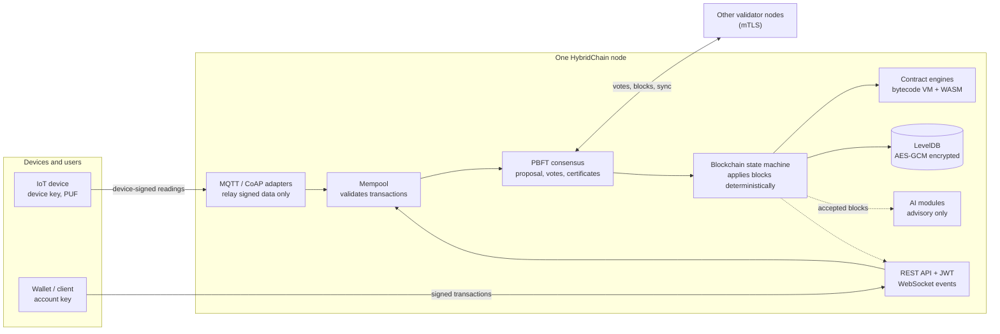
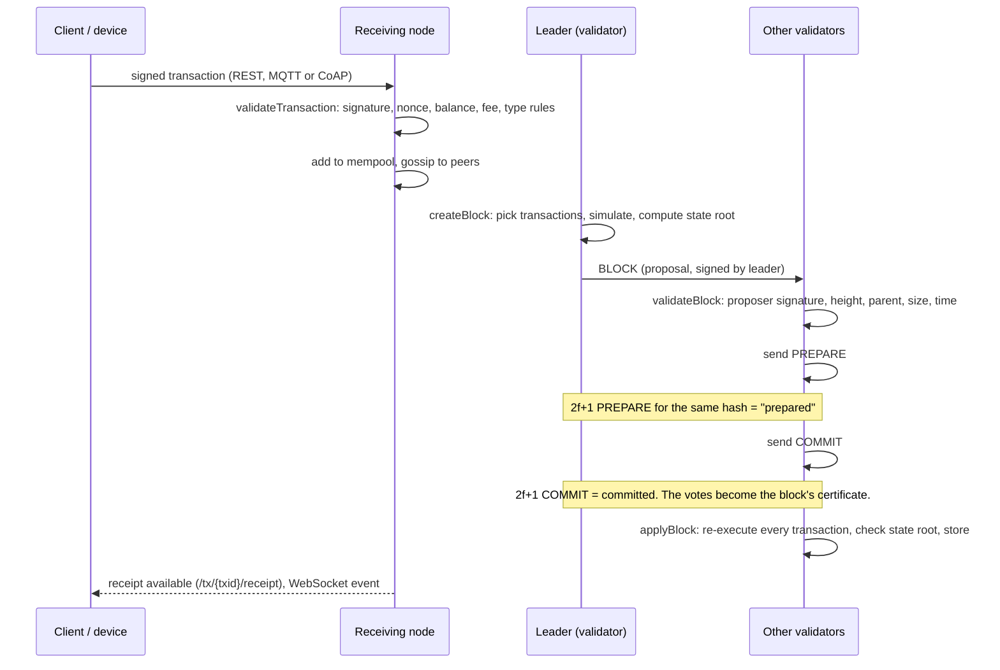
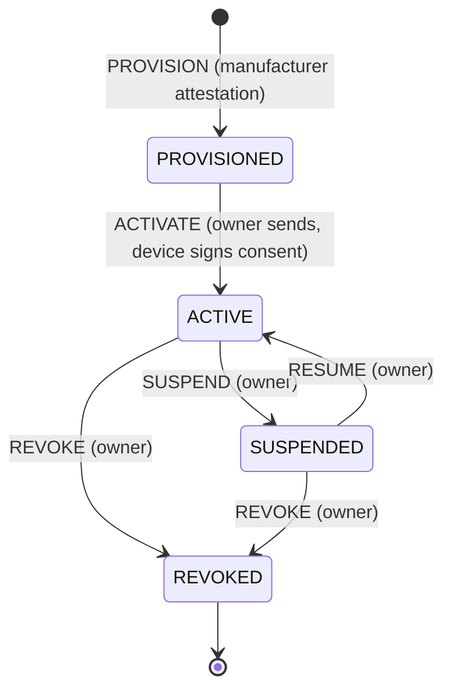

# HybridChain Explained

A complete guide to what HybridChain is, why it exists, how every part works, and what state it is in.

| | |
|---|---|
| **Project** | HybridChain (`blockchain-java`) |
| **Language / stack** | Java 17, Maven, Spring Boot 3.5.16, BouncyCastle 1.86, LevelDB, Chicory WASM 1.0.0 |
| **Entry point** | `com.hybrid.App` |
| **Size** | 96 main source files (about 21,400 lines), 157 test files, 695 tests |
| **Status** | Ready for a private testnet or supervised pilot. Not yet ready for production or for a public cryptocurrency. |
| **Written** | 21 October 2026, after two security-audit rounds |

---

## Contents

1. [What HybridChain is for](#1-what-hybridchain-is-for)
2. [The big picture](#2-the-big-picture)
3. [Words you need](#3-words-you-need)
4. [Node roles and how a node starts](#4-node-roles-and-how-a-node-starts)
5. [Data structures: blocks, transactions, state](#5-data-structures-blocks-transactions-state)
6. [All transaction types](#6-all-transaction-types)
7. [The life of a transaction](#7-the-life-of-a-transaction)
8. [Consensus: how nodes agree (PBFT)](#8-consensus-how-nodes-agree-pbft)
9. [Networking: peers, gossip and sync](#9-networking-peers-gossip-and-sync)
10. [Storage](#10-storage)
11. [Cryptography](#11-cryptography)
12. [Economics: supply, rewards and fees](#12-economics-supply-rewards-and-fees)
13. [Smart contracts](#13-smart-contracts)
14. [IoT: devices, telemetry and hardware](#14-iot-devices-telemetry-and-hardware)
15. [Identity: DIDs and verifiable credentials](#15-identity-dids-and-verifiable-credentials)
16. [Privacy and zero-knowledge proofs](#16-privacy-and-zero-knowledge-proofs)
17. [AI features](#17-ai-features)
18. [APIs: REST, WebSocket, MQTT, CoAP](#18-apis-rest-websocket-mqtt-coap)
19. [Configuration](#19-configuration)
20. [Building, testing and running](#20-building-testing-and-running)
21. [Security status](#21-security-status)
22. [Known limitations and what comes next](#22-known-limitations-and-what-comes-next)
23. [Map of the source code](#23-map-of-the-source-code)

---

## 1. What HybridChain is for

### The problem

Internet-of-Things systems collect data from thousands of devices: temperature sensors, meters, trackers, machines. Normally that data flows to one company's server. Whoever controls the server can change readings, delete history, or claim a device sent something it never sent. When several organizations share the data (a manufacturer, an operator, an insurer, a regulator), nobody can be sure the others did not tamper with it.

### The answer HybridChain gives

HybridChain is a **permissioned blockchain for IoT**. A fixed group of known organizations runs the validator nodes. Together they keep one shared, tamper-evident record of:

- **which devices exist**, who made them, who owns them, and whether they are active, suspended or revoked;
- **what each device reported**, with each reading signed by the device itself;
- **value transfers** between accounts, using the chain's built-in coin and user-created tokens;
- **small programs (smart contracts)** that react to data, for example triggering an actuator when a reading crosses a limit.

No single participant can rewrite history. Changing a past record would need the agreement of more than two-thirds of the validators, and every node would see the attempt.

### Why "hybrid"

The name reflects several combinations in one system:

| Combination | What it means here |
|---|---|
| **Account model + UTXO model** | Balances can be held as account balances (like Ethereum) or as unspent outputs (like Bitcoin). |
| **Classical + post-quantum cryptography** | Transactions are signed with secp256k1 ECDSA *and* ML-DSA (a NIST post-quantum standard). |
| **Bytecode VM + WebAssembly** | Contracts can be written for a small built-in stack machine or compiled to WASM. |
| **On-chain + off-chain data** | Readings, hashes and permissions live on-chain; large or private data can stay off-chain. |
| **Blockchain + AI** | Federated learning, anomaly detection and threat scoring run next to the chain, without being allowed to change consensus. |

### Who it is for

- IoT operators who want an audit trail that other parties can trust;
- consortia of companies sharing device data (supply chains, energy, smart buildings, fleets);
- researchers studying blockchain for IoT (the code references several research papers and includes formal models).

### What it is not (yet)

It is not a public cryptocurrency like Bitcoin or Ethereum. Anyone can read from it, but only listed validators can produce blocks. The coin has no decimals, and there is no staking. Section 22 and the separate roadmap explain what a public coin would need.

---

## 2. The big picture



Every node runs the same program. The arrows into the state machine all pass a signature or quorum check. AI and monitoring read accepted blocks and never write consensus state. That rule is enforced because earlier versions broke consensus by letting node-local AI state influence validity.

---

## 3. Words you need

| Term | Meaning |
|---|---|
| **Block** | A batch of transactions, linked to the previous block by its hash. |
| **State** | The current balances, nonces, contracts, devices and identities: the result of applying every block so far. |
| **State root** | One hash that summarizes the whole state. If two nodes have the same state root, they have the same state. |
| **Validator** | A node allowed to propose blocks and vote. Listed in `VALIDATOR_PUBKEYS`. |
| **f** | The number of faulty or malicious validators the network can tolerate: `f = floor((n - 1) / 3)`. |
| **Quorum** | The number of votes needed to decide: `ceil((n + f + 1) / 2)`. For 4 validators it is 3. |
| **Finality** | Once a block is committed by a quorum, it can never be reverted. PBFT gives this immediately. |
| **View** | A numbered period with one leader. A view change replaces a leader that is faulty or slow. |
| **Nonce** | A per-account counter. Each transaction must use the next number, which prevents replaying old transactions. |
| **Gas** | A unit of computation cost for contracts, paid for through the fee. |
| **DID** | Decentralized identifier: a self-owned identity, for example for a device. |
| **VC** | Verifiable credential: a signed statement about a DID, such as "this device was made by X". |
| **PUF** | Physically unclonable function: a hardware fingerprint used to derive a device key. |
| **Nullifier** | A one-time value that marks something as "used", so it cannot be used twice. |

---

## 4. Node roles and how a node starts

### Roles

Set with `NODE_ROLE` (`Config.NodeRole`):

| Role | What it does |
|---|---|
| `VALIDATOR` | Takes part in PBFT, proposes blocks when it is leader, votes. |
| `OBSERVER` (default) | Keeps a full copy of the chain and state, never votes. |
| `GATEWAY` | Accepts device data over MQTT/CoAP and relays it to validators. |
| `LIGHT` | Intended to keep only headers and verify Merkle proofs. Not fully implemented. |

### Startup sequence (`com.hybrid.App.main`)

1. **Read the node key** from `NODE_PRIVATE_KEY`, and derive the public key and the node address (`hb...`).
2. **Read the validator set** from `VALIDATOR_PUBKEYS` (comma-separated hex public keys). PBFT requires at least 4.
3. **Create the network certificate authority** from `NETWORK_CA_SEED`. Every node derives the same CA, so they can verify each other's certificates. It is deliberately separate from the disk-encryption key (finding HC-003).
4. **Generate a TLS key pair** for this node and **issue it a certificate** signed by that CA.
5. **Create PBFT consensus** with the validator set and this node's identity.
6. **Open storage** (LevelDB at `STORAGE_PATH`, encrypted with `STORAGE_AES_KEY`).
7. **Create the blockchain**: a normal `Blockchain`, or a `PrunedBlockchain` that keeps only the last `MAX_BLOCKS` blocks.
8. **Initialize it** (`blockchain.init()`): resume from the stored tip, or fast-sync from a verified local checkpoint, or create the deterministic genesis block (fixed timestamp 1 January 2026, `Config.GENESIS_TIMESTAMP`).
9. **Start the P2P node** with its CA-signed certificate, connect PBFT to it, and load the on-chain jail list into consensus.
10. **Register the equivocation reporter**: if this node sees a validator vote twice, it submits on-chain evidence automatically.
11. **Start the block proposer** (every `TARGET_BLOCK_TIME_MS`, default 60 s). When this node is the leader, it builds, signs and broadcasts a block.
12. **Seed nodes** (`IS_SEED=true`) broadcast their peer list every 30 seconds.
13. **Start the REST API** (Spring Boot on `API_PORT`, default 8080). If it fails, the node exits instead of running half-alive (HC-009).

A legacy launcher, `com.hybrid.blockchain.App`, still exists but is not the packaged entry point.

---

## 5. Data structures: blocks, transactions, state

### Block (`Block.java`)

| Field | Purpose |
|---|---|
| `index` | Height (genesis = 0). |
| `timestamp` | Milliseconds. Must be newer than the parent and not more than 15 s in the future. |
| `prevHash` | Hash of the previous block. This is the chain link. |
| `transactions` | The transactions in the block. |
| `txRoot` | Merkle root of the transactions. |
| `stateRoot` | State root after applying this block. Every node recomputes it and must match. |
| `nonce`, `difficulty` | Leftovers from a proof-of-work design. Not used for security under PBFT. |
| `hash` | Hash of the canonical encoding of the fields above. |
| `validatorId` | Address of the proposer. |
| `signature` | Proposer's signature over the block hash. |
| `commitCertificate` | The COMMIT signatures of a quorum of validators. **Not** part of the hash (the voters sign the hash). It lets any node, including one that is syncing later, prove the block is final. |

The block's canonical encoding is binary and length-prefixed, with a `BLOCK\0` domain prefix, so it cannot be confused with any other signed message.

### Transaction (`Transaction.java`)

| Field | Purpose |
|---|---|
| `version` | Encoding version (1). |
| `type` | One of the transaction types in section 6. |
| `networkId` | Chain identifier (`NETWORK_ID`, default 101). Prevents replaying a transaction on another network. |
| `from`, `to` | Sender and receiver addresses. |
| `amount`, `fee` | Value transferred and fee paid. |
| `nonce` | Sender's next counter value. |
| `timestamp` | Creation time. |
| `validUntilBlock` | Optional expiry height. |
| `data` | Type-specific payload (contract code, JSON for device actions, proofs, and so on). |
| `inputs`, `outputs` | Used by UTXO transactions. |
| `pubKey`, `signature` | ECDSA public key and signature. The address must match the key. |
| `dilithiumPublicKey`, `dilithiumSignature` | ML-DSA public key and signature (post-quantum). |
| `txid` | Computed from the canonical encoding, never taken from the wire (HC-029). |

The signed encoding starts with the domain prefix `TX\0` and writes every field with fixed sizes or length prefixes. The transaction type is written as its position in the enum. That is why new types are always added at the end.

### State (`AccountState.java`)

The state contains:

- **Accounts** in a Merkle-Patricia trie (`MerklePatriciaTrie.java`): balance, nonce, token balances, contract code, contract storage and contract capabilities.
- **The identity registry** (`SSIManager`): DIDs and credentials.
- **The device registry** (`DeviceLifecycleManager`): every device's record and history.
- **Spent nullifiers**: for zero-knowledge and one-time proofs.
- **Jailed validators**: validators punished by on-chain evidence.

**State root** = hash of (account trie root, identity hash, device hash, nullifier hash, and, once non-empty, the jail-list hash). Collections are sorted before hashing, so every node computes the same bytes.

### UTXO set (`UTXOSet.java`)

A Bitcoin-style set of unspent outputs, kept alongside the accounts. A UTXO spend must be signed by the owner of every input, outputs must be positive, and the inputs must cover the outputs plus the fee (HC-018).

---

## 6. All transaction types

| Type | What it does | Who may send it | Key checks |
|---|---|---|---|
| `ACCOUNT` | Transfer coins between accounts. | Any account holder. | Signature, nonce, balance ≥ amount + fee. |
| `UTXO` | Spend unspent outputs. | Owner of every input. | Inputs owned, outputs positive, sums balance. |
| `CONTRACT` | Deploy a contract (`to` empty) or call one. | Any account holder. | Code-size limit, static code audit, gas limit = fee × 1000 (capped). |
| `IOT_MANAGEMENT` | Device actions: `PROVISION`, `ACTIVATE`, `SUSPEND`, `RESUME`, `REVOKE`, `UPDATE_FIRMWARE`. | Manufacturer (provision) or owner (others). | Manufacturer attestation, device consent for activation, manufacturer signature for verified firmware. |
| `MINT` | Block reward. | Only the protocol, at most one per block, paid to the proposer. | Amount = scheduled reward, never above maximum supply. |
| `BURN` | Destroy own coins. | Holder. | Balance. |
| `TOKEN_REGISTER` | Create a new token (name, symbol, decimals, max supply). | Anyone. The sender becomes the token owner. | Unique token ID. |
| `TOKEN_MINT` / `TOKEN_BURN` | Create or destroy token units. | Token owner / holder. | Max supply, balance. |
| `TOKEN_TRANSFER` | Move token units. | Holder. | Token balance. |
| `TELEMETRY` | Record a device reading. | The device, its owner, or a gateway relaying a device-signed reading. | Device is active. The reading is signed by the device, or for PUF devices carries a proof bound to this transaction and payload. |
| `TELEMETRY_BATCH` | Many readings in one transaction from a gateway. | Gateway. | Format only. The readings are **not** device-signed, so they are logged but never trusted for AI training. |
| `FEDERATED_UPDATE` | Submit local AI model weights. | Participating node. | Applied only after the block is accepted. |
| `FEDERATED_COMMIT` | Commit an aggregated AI model. | Validator. | Model hash must match the weights. |
| `PRIVATE_TRANSFER` | **Disabled** (O-6). It never moved value. | Nobody. | Always rejected. Kept in the enum only so later types keep their numbers. |
| `EQUIVOCATION_EVIDENCE` | Prove a validator voted for two different blocks at the same height and view. Jails it. | Anyone (nodes submit it automatically). | Both votes correctly signed by that validator, same phase, view and height, different blocks. |

All signed transactions pay at least the current base fee (HC-033).

---

## 7. The life of a transaction



Step by step:

1. **Signing.** The client signs the canonical encoding with its ECDSA key and its ML-DSA key.
2. **Submission.** Over REST (`POST /api/v1/transactions/submit-signed` with a JWT for the sender), CoAP (`/tx`) or MQTT. The node never signs on the client's behalf.
3. **Validation.** `Blockchain.validateTransaction` checks the signature, network ID, nonce, balance, fee, expiry and the rules for that type.
4. **Mempool.** Valid transactions wait in the mempool (limit 10,000) and are gossiped to peers.
5. **Proposal.** The current leader builds a block from the mempool. It simulates every transaction on a copy of the state to compute the state root, then signs the block.
6. **Voting.** Validators check the proposal (including the proposer's signature) and vote PREPARE, then COMMIT (section 8).
7. **Applying.** Once committed, every node re-executes the block. If its computed state root differs from the block's, the block is rejected. Failed transactions still pay their fee and use their nonce, but the proposer is not credited fees for failed transactions (HC-017).
8. **Results.** A receipt (success, reverted or failed, gas used, events) is stored. Events go to WebSocket subscribers.

---

## 8. Consensus: how nodes agree (PBFT)

The engine is **Practical Byzantine Fault Tolerance** (`consensus/PBFTConsensus.java`). It is safe as long as at most `f` of `n` validators are faulty.

### Quorum

`quorumSize(n) = ceil((n + f + 1) / 2)` with `f = floor((n - 1) / 3)`. For n = 4, 5, 7 and 10 the quorums are 3, 4, 5 and 7. The original code used `2f + 1`, which is only correct when `n = 3f + 1`. With 5 validators it allowed two conflicting blocks to both be "certified" (HC-002, fixed).

### Leader selection

Round-robin: the leader of view `v` is `eligible[v mod n]`, where `eligible` is the validator list sorted by address, without jailed validators (HC-082). It depends only on the view, the configured validators and the on-chain jail list, so all nodes at the same height agree.

Earlier versions weighted the choice by reputation. Reputation is node-local: nodes that changed views along different paths, synced blocks instead of committing them, or saw a double vote that others didn't ended up with different scores. In the first live Docker test, the three survivors of a leader crash all reached view 3 but picked different leaders, and the chain stopped. Reputation is still tracked, for monitoring only. `docs/formal/` documents the old weighted scheme and why it fails.

### Normal case

1. **Proposal.** The leader broadcasts a signed block.
2. **PREPARE.** Each validator that accepts the proposal signs PREPARE(view, height, hash).
3. **COMMIT.** When a validator sees 2f+1 PREPAREs for the same hash, it signs COMMIT for **that** hash. It never commits two different blocks at one height in one view.
4. **Apply.** When 2f+1 COMMITs for the same hash exist, the block is applied, and its commit certificate is attached and stored.

Each vote is signed over a length-prefixed binary encoding with the domain tag `HYBRIDCHAIN-PBFT-v2` (HC-066).

### What makes a block final

`verifyBlock` accepts a block only if:

- the proposer's signature verifies, **and**
- this node saw the commit quorum itself, **or** the block's certificate holds valid COMMIT signatures from a quorum of distinct, known, non-jailed validators, **or** the network has a single validator.

Before HC-046, one leader's signature was enough. That was the most serious consensus finding.

### View change and NEW_VIEW (leader failure)

If no block commits within the timeout (15 s), validators send VIEW_CHANGE for the next view. Each one carries a **prepared proof**: the block this validator saw prepared, with its 2f+1 PREPARE signatures. When the new leader has 2f+1 view changes, it sends a signed **NEW_VIEW**. NEW_VIEW contains those view changes and re-proposes the prepared block with the highest view, or nothing if none was prepared. Every node re-derives that choice and rejects a NEW_VIEW that proposes anything else. This guarantees that a block committed anywhere is never replaced, and that the chain does not stall when a leader dies at the wrong moment.

### Misbehaviour: equivocation evidence

If a validator signs two different blocks for the same phase, view and height, anyone holding both signatures can submit an `EQUIVOCATION_EVIDENCE` transaction. Every node verifies it and adds the validator to the **jail list** in the state. A jailed validator is never elected leader, its votes are refused, and it does not count in certificates. Locally observed misbehaviour is only a log entry. Only the on-chain jail list affects consensus, so all nodes stay in agreement (HC-078).

### Alternative engine

`PoAConsensus.java` implements a simpler proof-of-authority engine (round-robin signer), mainly used in tests.

---

## 9. Networking: peers, gossip and sync

### Transport (`PeerNode.java`, `security/SSLUtils.java`, `security/CertificateAuthority.java`)

- All peer connections use **mutual TLS**. Both sides present certificates issued by the network CA. There is no "trust everything" fallback (HC-006).
- After TLS, a **signed handshake** (protocol version 2) proves the peer owns its node key, and checks that the key belongs to a known validator or an allowed peer (HC-011, HC-042).
- Handshake buffers are size-limited (HC-007), sockets have timeouts, and the thread pool is bounded (HC-012).

### Messages (`p2p/P2PMessage.java`)

`TRANSACTION`, `BLOCK`, `CONSENSUS` (PREPARE, COMMIT, VIEW_CHANGE, NEW_VIEW), `PEER_DISCOVERY`, `PING`/`PONG`, `REQUEST_BLOCKS`, `BLOCKS_RESPONSE`, `CHECKPOINT`, `GOSSIP`. Every message is signed by its sender and size-limited (HC-044).

### Gossip (`p2p/GossipEngine.java`, `p2p/PeerManager.java`)

Messages spread to a random subset of peers, with duplicate suppression. Each peer has a score that drops on bad behaviour; low scores lead to temporary bans. Discovered addresses are only candidates until a real authenticated connection exists (HC-045).

### Catching up (block sync)

Each node advertises its height in its peer list. A node that is behind asks the highest peer for missing blocks, at most 50 per request and per response. Every synced block must carry a valid commit certificate and is fully re-executed (HC-046, HC-067, HC-068).

### Checkpoints

Every 1,000 blocks, validators sign a checkpoint (height, block hash, state root, UTXO root). A checkpoint is saved once a quorum of verified signatures exists. On restart from an empty tip, a node can fast-sync from a stored checkpoint, but only if the signatures, the block, the state root and the UTXO root all match (HC-043, HC-069, HC-070).

---

## 10. Storage

`Storage.java` uses **LevelDB**. Every value is encrypted with **AES-GCM**, and the record's key is bound in as authenticated data, so an encrypted value cannot be moved under a different key (HC-041). Keys themselves are hashed before use.

| Key pattern | Content |
|---|---|
| `block:<hash>` | Full block, including its commit certificate. |
| `height:<n>` | Block hash at height n. |
| `chain:tip` | Current tip (written with a synchronous disk write). |
| `state:account` | Serialized account state. |
| `utxo:set` | UTXO set. |
| `receipt:<txid>` | Transaction receipt. |
| `addridx:<address>:<sortkey>` | Index of transactions per address (for paging). |
| `telemetry:...` | Stored device readings. |
| `snapshot:<height>` | State snapshots (last 16 kept). |
| `checkpoint:<height>` | Quorum-signed checkpoints. |
| `meta:<key>` | Metadata such as last checkpoint height, total minted and base fee. |

A rejected block leaves no stored side effects (HC-024). Writes are staged and committed only after the block is accepted.

---

## 11. Cryptography

| Use | Algorithm | Notes |
|---|---|---|
| Account and validator signatures | ECDSA on secp256k1, SHA-256 | Low-S enforced. The full 32-byte digest is signed; an old bug signed only part of the message (HC-040). |
| Post-quantum signatures | ML-DSA (FIPS 204) via BouncyCastle | Required on every transaction by default (`REQUIRE_QUANTUM_SIG=true`). See the open finding HC-079 below. |
| Addresses | `"hb"` + 20 bytes of hash(ECDSA key), or `"hq"` + 20 bytes of hash(domain, ECDSA key, ML-DSA key) | `hq` accounts are bound to both keys (HC-079). No checksum yet. |
| Hashing | SHA-256, with `Crypto.hashWithDomain` for domain separation | Every signed structure has its own domain tag. |
| Merkle trees | `MerkleTree.java` (transactions), `MerklePatriciaTrie.java` (accounts, contract storage) | The odd-leaf duplication bug is fixed (HC-030). |
| Storage encryption | AES-GCM with AAD | |
| Transport | TLS with mutual certificates (secp256r1 node keys) | |
| API tokens | JWT HS256 | The public development secret works only in DEBUG mode (HC-052). |
| Device keys | Derived from a PUF response (`PUFIdentityProvider`) or provisioned | |

**Domain tags in use:** `TX\0`, `BLOCK\0`, `HYBRIDCHAIN-PBFT-v2`, `HYBRIDCHAIN-CHECKPOINT-v2`, `HYBRIDCHAIN-ZK-TELEMETRY-v1`, `HYBRIDCHAIN-ZK-PRIVATE-TRANSFER-v1`, `HYBRIDCHAIN-FIRMWARE-v1`, plus the handshake and credential domains.

> **HC-079: two kinds of account.** A classical **`hb`** address is derived from the ECDSA key only. The ML-DSA signature that `REQUIRE_QUANTUM_SIG=true` requires on it is not tied to the account, so it gives **no** post-quantum protection. A hybrid **`hq`** address is `"hq" + hash(domain, ecPub, mldsaPub)[0..20]`. It commits to both keys, so spending needs both private keys, whatever `REQUIRE_QUANTUM_SIG` says. Holders who want protection against a future quantum attacker must move funds to an `hq` address (`Transaction.Builder.signHybridBound`). Transactions from `hq` addresses are valid from `Config.HYBRID_ADDRESS_ACTIVATION_HEIGHT` (0 for new networks). Validator identities and block rewards are still `hb`. Reasoning: `docs/decisions/HC-079-hybrid-address-binding.md`.

---

## 12. Economics: supply, rewards and fees

### Supply (`Tokenomics.java`)

- Maximum supply: **21,000,000** units.
- Block reward: **50** units, halving every **210,000** blocks, minimum 1, and zero once the maximum is reached.
- Exactly one `MINT` per block, paid to the proposer (HC-016).

These numbers are counted in the smallest unit, so the coin has **no decimals**: one unit is the smallest amount anyone can own. That is fine for an IoT pilot, but a real currency needs, for example, 10⁸ base units per coin.

### Fees (`FeeMarket.java`)

An EIP-1559-style fee market:

- a **base fee** that rises when blocks are fuller than the target (half the maximum) and falls when they are emptier, changing by at most 1/8 per block;
- the base-fee part is **burned**;
- any amount above the base fee goes to the block proposer;
- the base fee is consensus state and is rolled back correctly on fork revert (HC-022).

### Fee estimate

`GET /api/v1/fee/estimate` returns the current base fee. `GET /api/v1/ai/fee-prediction` gives an AI-based estimate, which is advisory only.

---

## 13. Smart contracts

Contracts are deployed with a `CONTRACT` transaction whose `to` is empty. The code is stored in the new contract account. The contract address is derived from the creator and its nonce. If the code starts with the WASM magic bytes, it runs on the WASM engine; otherwise on the bytecode VM.

### Safety around execution

- Contract execution runs on a **copy of the state**. Only a successful run is merged back. A revert or failure discards changes, but the fee and nonce are still charged (HC-017).
- **Gas limit** = fee × 1000, with overflow-safe multiplication (HC-062).
- A static auditor (`ai/SmartContractAuditor.java`) rejects obviously dangerous code at deploy time (it can be bypassed only in tests).
- Maximum code size: 32 KB.

### Bytecode VM (`Interpreter.java`, `OpCode.java`)

A stack machine with 64-bit integers, a stack limit of 1,024 (HC-057), memory and per-contract persistent storage (`ContractState`, also a Merkle-Patricia trie).

| Opcode | Byte | Gas | Effect |
|---|---|---|---|
| STOP | 0x00 | 0 | End |
| PUSH | 0x01 | 1 | Push the next 8 bytes |
| POP / DUP / SWAP | 0x02 / 0x03 / 0x04 | 1 / 1 / 2 | Stack operations |
| ADD / SUB / MUL / DIV / MOD | 0x10–0x14 | 3 / 3 / 5 / 5 / 5 | Arithmetic |
| JUMP / JUMPI | 0x20 / 0x21 | 8 / 10 | Jump, conditional jump |
| EQ / LT / GT | 0x22–0x24 | 3 | Comparisons |
| AND / OR / NOT | 0x25–0x27 | 2 | Logic |
| SLOAD / SSTORE | 0x30 / 0x31 | 200 / 5000 | Read and write persistent storage |
| MLOAD / MSTORE | 0x32 / 0x33 | 3 | Read and write memory |
| BALANCE / SELFBALANCE | 0x40 / 0x45 | 20 / 5 | Balances |
| CALLER / VALUE / TIMESTAMP / NUMBER | 0x41–0x44 | 2 | Context |
| SYSCALL | 0x50 | 100 | 1 = read sensor from chain state, 2 = queue actuator (needs a capability) |
| LOG | 0xa0 | 375 | Emit an event |
| CALL / DELEGATECALL | 0xf1 / 0xf4 | 700 | Call another contract |
| RETURN / REVERT | 0xf3 / 0xfd | 0 | End with data / undo |

### WASM engine (`WasmContractEngine.java`)

Contracts compiled to WebAssembly run on Chicory, a pure-Java WASM interpreter. The entry function is `main`.

- **Gas** is charged for every instruction (1 gas each), for every 64 KiB memory page grown (1,000 gas), and for bulk memory copies. It is capped at 10,000,000 per call. Every node therefore stops at exactly the same point. The old engine relied on a 5-second wall-clock timeout, which splits consensus between fast and slow machines (HC-059). A 30-second timeout remains only as a safety net.
- **Host functions:** `hb_state_read`, `hb_state_write` (contract storage), `hb_read_sensor` (chain state, see below), `hb_get_gas`.
- Parsed modules are cached in a 64-entry LRU (HC-061).

### Capabilities and actuators

Contracts can only touch hardware if their account holds a `Capability` (`READ_SENSOR` or `WRITE_ACTUATOR` for a given ID). Actuator commands are not executed immediately. They are queued (`DeferredAction`) and executed only after the block is 6 blocks deep.

### What contracts cannot do yet

Contracts cannot send coins or tokens out of their own account, compute hashes or check signatures. WASM contracts cannot see the caller or the value sent. This blocks escrow-style applications (crowdfunding, marketplaces, DeFi).

### Sensor reads (HC-058)

Contracts read sensors from **chain state**, never from the node's hardware, so every node gets the same value. A device's sensor ID is the first 8 bytes of `hashWithDomain("HYBRIDCHAIN-SENSOR-ID-v1", deviceId)` (`lifecycle/SensorReadings.sensorId`). The value is the latest device-authenticated `TELEMETRY` reading in milli-units: `21.5` or `{"value":21.5}` becomes `21500`, parsed as a decimal. Device-authenticated means one of these: signed by the device's registered key and checked against the block timestamp; a bound PUF proof; or sent by the device's own key. A number the owner or a gateway typed in is stored as telemetry but never fed to contracts. With no reading, contracts get `SensorReadings.NO_READING` (`Long.MIN_VALUE`). The readings are part of the state root once there is at least one.

---

## 14. IoT: devices, telemetry and hardware

### Device lifecycle (`lifecycle/DeviceLifecycleManager.java`)



- **PROVISION.** A trusted manufacturer signs (device ID, manufacturer, model, device public key). Only registered manufacturers are accepted. For PUF devices, a deterministic nullifier is stored (HC-049).
- **ACTIVATE.** The future owner sends the transaction and must be the one named as owner. The device must sign its consent with its attested key (HC-047). This stops strangers from claiming devices.
- **SUSPEND / RESUME / REVOKE.** Owner only.
- **UPDATE_FIRMWARE.** Owner only. The update counts as **verified** only if the device's manufacturer signed `firmwareDigest(deviceId, version, hash)`; otherwise it is marked unverified and the device's reputation drops by 20% (HC-074).
- The whole record (owner, keys, firmware history, metadata) is part of the state root (HC-048).

### Telemetry (device readings)

A `TELEMETRY` transaction is accepted only if one of these holds:

1. the sender is the device's owner;
2. the sender is the device itself (non-PUF devices, matched by DID key);
3. it is a **PUF device** and the data carries an ownership proof whose challenge is derived from (device, sender, sender nonce, payload). A copied proof is useless (HC-071);
4. a gateway relays a **`DeviceReading`** signed by the device with its registered key, with a timestamp inside the accepted window (HC-013).

Readings are stored per device and per block. They can be read through `GET /api/v1/devices/{deviceId}/telemetry`, with at most 10,000 blocks and 1,000 records per request (HC-056).

### Device data channels

| Channel | Class | What it accepts |
|---|---|---|
| MQTT | `api/MQTTAdapter.java` | Topic `blockchain/iot/<device>/telemetry`: a device-signed reading. Topic `blockchain/iot/<device>/mgmt`: a full **owner-signed** `IOT_MANAGEMENT` transaction. The node never signs management actions for a publisher (HC-064). |
| CoAP | `api/CoAPAdapter.java` | `/health`, `/balance?address=`, `/tx` (a signed transaction), `/telemetry` (a device-signed reading). Rate limit per sender. |
| Private data | `privacy/PrivateDataCollection.java` | Encrypted data readable by authorized members, with public hashes for integrity. |

Note: older copies of the MQTT and CoAP adapters also exist in the `iot` package. The ones in `api` are the current ones.

### Hardware abstraction (`HardwareManager.java`)

Actuators only (simulated relay 100). Real drivers would replace it. Sensor values for contracts come from chain state (HC-058).

### Hardware security

- `security/PUFIdentityProvider.java`: derives a device key from a PUF response.
- `security/PufAnchorRegistry.java`: stores a hash of the PUF response on-chain at provisioning, to check later authentications.
- `security/HardwareSecurityModule.java`: a **simulated** HSM interface (a real one would use PKCS#11 or a cloud HSM).

---

## 15. Identity: DIDs and verifiable credentials

- **DIDs** (`identity/DecentralizedIdentifier.java`, `identity/SSIManager.java`): identities of the form `did:hybrid:...`, each with verification keys. Devices get DIDs at provisioning.
- **Verifiable credentials** (`identity/VerifiableCredential.java`): signed statements such as "manufactured by X" or "certified for Y". They have real expiry dates in ISO-8601 format, and a credential whose expiry cannot be parsed counts as expired. The signed encoding is unambiguous (HC-050).
- **Multisig** (`security/MultiSigManager.java`): M-of-N wallets whose proposals require verified signatures from the listed owners (MSIG-1).
- **Reputation** (`reputation/ReputationEngine.java`): a score per device, stored under `rep:<deviceId>`, lowered by unverified firmware and other penalties.

This identity layer is the base for credential use cases outside IoT as well: diplomas, licences and reusable identity checks.

---

## 16. Privacy and zero-knowledge proofs

`privacy/ZKProofSystem.java` implements Pedersen commitments and Schnorr-style proofs (Fiat-Shamir) on secp256k1:

| Proof | Used for | Status |
|---|---|---|
| Ownership proof (Schnorr) | Prove knowledge of a key without revealing it (PUF telemetry). | Kept. The challenge is bound to the transaction. |
| Equality proof | Two commitments hide the same value. | Kept as a building block. |
| Range, threshold and firmware "proofs", eligibility gate | Range checks, validator eligibility, firmware integrity | **Removed (O-7).** The range proof accepted a commitment to −5 as being in [0, 100] and leaked the value. The threshold proof was built on it. The firmware proof could only be checked with the device secret. The gate's commitment was chosen by the prover. Evidence: `docs/decisions/O-7-unsound-zk-removal.md`. |

"Kept" means reviewed, not formally proven or externally audited.

`PRIVATE_TRANSFER` is disabled (O-6): it never moved value, so every such transaction is rejected.

---

## 17. AI features

All AI components are **advisory**. They read accepted blocks and authenticated data, and they never change balances, validity or leader selection. Several audit findings came from AI state leaking into consensus (HC-019, HC-026, HC-077).

| Component | File | What it does |
|---|---|---|
| Federated learning | `ai/FederatedLearningManager.java` | Nodes submit model weight updates, which are aggregated into a shared model. Committed models are hash-checked and accepted only from validators (HC-051). Updates are applied only after their block is accepted (HC-077). |
| Differential privacy | `ai/DPMechanism.java` | Adds calibrated noise from `SecureRandom` to aggregated weights (epsilon = 1.0 by default). |
| Telemetry anomaly detector | `ai/TelemetryAnomalyDetector.java` | Z-score plus an ARIMA(1,1,1) approximation over a 50-reading window. Runs after a block is accepted, on authenticated `TELEMETRY` only, and publishes alerts to the `anomalies` WebSocket topic. |
| Predictive threat scorer | `ai/PredictiveThreatScorer.java` | Moving-average score of validator behaviour, for monitoring. Deliberately not used in leader selection. |
| Smart-contract auditor | `ai/SmartContractAuditor.java` | Static scan of bytecode for dangerous patterns before deployment. |

---

## 18. APIs: REST, WebSocket, MQTT, CoAP

### REST (`api/IoTRestAPI.java`, base path `/api/v1`)

**Security rules** (`security/SecurityConfig.java`): `GET` requests are public. `POST`, `PUT` and `DELETE` need a JWT. Admin endpoints also need the token to belong to an admin. Write endpoints check that the token belongs to the account acting.

| Group | Endpoints |
|---|---|
| Health | `GET /health`, `/ready`, `/metrics` (Prometheus), `/chain/height`, `/chain/status`, `/chain/tip` |
| Accounts | `GET /accounts/{address}`, `GET /proof/{address}` (Merkle proof), `POST /account/create` (DEBUG only, HC-053) |
| Transactions | `POST /transactions/submit-signed` (client-signed, JWT must match the sender), `POST /transactions/submit` (retired, returns 410), `GET /transactions/{txId}`, `/transactions/pending`, `/tx/{txid}/receipt`, `/address/{address}/transactions?limit=&cursor=` (max 100) |
| Blocks | `GET /blocks/latest`, `/blocks/height/{height}`, `/blocks/{hash}` |
| Explorer | `GET /explorer/address/{address}`, `/explorer/block/{hash}`, `/explorer/tx/{txId}` |
| Consensus and network | `GET /consensus`, `/consensus/reputation`, `/network/status`, `/network/peers`, `/checkpoint/latest`, `/checkpoint/{height}` |
| Economics and tokens | `GET /tokenomics`, `/fee/estimate`, `/tokens/{tokenId}`, `/tokens/{tokenId}/balance/{address}` |
| Contracts | `GET /contracts/{address}/abi`. Deploy and call go through `submit-signed` (the old endpoints point there). |
| IoT | `GET /iot/devices/{deviceId}`, `/devices/{deviceId}/telemetry?fromBlock=&toBlock=` |
| AI | `GET /ai/threat-scores`, `/ai/anomalies`, `/ai/anomalies/{deviceId}`, `/ai/federated/model`, `/ai/fee-prediction`; `POST /ai/federated/submit` (JWT must match the node ID, HC-055) |
| Admin | `GET /admin/status`, `/admin/peers`, `/admin/metrics`; `POST /admin/node/pause`, `/admin/node/resume`, `/admin/broadcast-block`; `DELETE /admin/peers/{peerId}` |

### WebSocket (`/ws/events`)

Send `{"action":"subscribe","topic":"blocks","filter":{"miner":"hb..."}}`. There are six topics: `blocks`, `transactions`, `mempool`, `contracts`, `anomalies`, `consensus`. Each topic has its own filter (at most 8 keys). An event that cannot be filtered is not sent (HC-063).

---

## 19. Configuration

Every setting can be given as an environment variable or a Java system property (`-DNAME=value`).

| Variable | Default | Meaning |
|---|---|---|
| `NODE_PRIVATE_KEY` | required (DEBUG falls back to key `1`) | This node's secp256k1 private key (hex). |
| `VALIDATOR_PUBKEYS` | required, at least 4 | Comma-separated validator public keys. |
| `NETWORK_CA_SEED` | required (DEBUG has a dev seed) | At least 32 bytes in hex, the same on every node, different from `STORAGE_AES_KEY`. |
| `STORAGE_AES_KEY` | required (DEBUG has a dev key) | Disk-encryption key for this node. |
| `STORAGE_PATH` | `./data` | LevelDB folder. |
| `P2P_PORT` | 6001 | Peer port (mTLS). |
| `API_PORT` | 8080 | REST API port. |
| `COAP_PORT` | 5683 | CoAP UDP port. |
| `MQTT_BROKER_URL` | `tcp://localhost:1883` | MQTT broker. Secure it with authentication and TLS. |
| `NETWORK_ID` | 101 | Chain ID inside every transaction. |
| `NODE_ROLE` | `OBSERVER` | `VALIDATOR`, `OBSERVER`, `GATEWAY` or `LIGHT`. |
| `IS_SEED` / `SEED_PEER` | false / none | Seed-node behaviour and the seed to contact. |
| `MIN_PEERS` | see `PeerManager` | Minimum peers for gossip (HC-001). |
| `MAX_BLOCKS` | 0 (keep all) | Keep only the last N blocks (`PrunedBlockchain`). |
| `REQUIRE_QUANTUM_SIG` | true | Require the ML-DSA signature on transactions. Must be the same on every node. |
| `MIN_FL_CONTRIBUTORS` | 3 | Minimum contributors for a federated-learning round. |
| `FEE_HISTORY_ENABLED` | true | Keep fee history. |
| `DEBUG` | false | Enables development fallbacks. **Never use in production.** |
| `SPRING_PROFILES_ACTIVE` / `NODE_ENV` | none | A `prod` profile or `production` env enables extra refusals of unsafe settings. |

Fixed protocol constants (in `Config.java`): block target time 60 s, max 2,000 transactions and 2 MB per block, mempool limit 10,000, timestamp drift 15 s, maximum code size 32 KB, genesis timestamp 1 January 2026 00:00 UTC.

Generate keys for a network with `scripts/generate_keys.sh` (random by default, file mode 600, never overwrites). Keep them out of git. Outside DEBUG, a node refuses any key or secret that was ever published in this repository (`security/CompromisedKeys`, O-3). Rotation steps: `docs/KEY_ROTATION.md`.

---

## 20. Building, testing and running

```bash
# Build and run all tests (offline, using cached dependencies)
mvn -o test

# Run the 30 audit proof tests (excluded from the normal run)
mvn -o test -Dtest=HybridChainAuditPoCTest -Daudit.excluded=none

# Build the runnable jar
mvn -o package -DskipTests

# Run a node (values from your own .env)
java -jar target/blockchain-java-1.0-SNAPSHOT-jar-with-dependencies.jar
```

Docker: the `Dockerfile` copies the jar, exposes ports 6001 and 8000, and runs as the unprivileged user `hybrid` (HC-076). Port 8000 works because the compose file sets `API_PORT=8000`; without it the API listens on 8080. `docker-compose.20nodes.yml` describes a 20-node test network.

Test suite: 695 tests (unit, integration, Byzantine fault injection, pentests, and the audit proofs), with 74.2% line coverage and 60.6% branch coverage. A TLA+ model of leader selection lives in `docs/formal/`.

---

## 21. Security status

Two audit rounds recorded **79 findings** (HC-001 to HC-079). Every critical finding is fixed, and each fix has a test that fails on the old code. Full detail is in the audit report, *HybridChain Security Audit II*.

The most important fixes, in plain words:

| Area | What used to be possible | Now |
|---|---|---|
| Consensus | One validator could finalize a block (HC-046). With 5 validators, two conflicting blocks could both be certified (HC-002). A dead leader could stall the chain. | Commit certificates from a quorum; correct quorum math; NEW_VIEW recovery; on-chain jailing for double votes. |
| Money | Unlimited minting per block (HC-016). Fees from failed transactions credited (HC-017). Unsigned UTXO spends (HC-018). | One scheduled mint to the proposer; fee rules fixed; UTXO spends signed and owned. |
| Determinism | Wall-clock timeouts, node-local AI state and local slashing changed validity, so nodes could disagree (HC-019, HC-026, HC-059, HC-078). | Every validity rule depends only on chain data. |
| Network | A 4-validator network never gossiped (HC-001). Production mTLS never worked (HC-005). Trust-all fallback (HC-006). | Working CA, mTLS and gossip; signed, bounded messages. |
| Devices | Anyone could claim a device (HC-047), relay unsigned readings (HC-013), control gateway-owned devices over MQTT (HC-064), or replay PUF proofs (HC-071). | Owner and device consent, device-signed readings, owner-signed management, bound proofs. |
| Operations | Public JWT secret (HC-052), published keys in the template (HC-075), root container (HC-076). | Debug-only secrets, blank template, non-root container. Dependencies were upgraded, cutting vulnerable libraries from 43 to 1. |

### Still open

| ID | Item | Risk |
|---|---|---|
| HC-079 | **Fixed for new `hq` accounts.** Classical `hb` accounts (including validator reward accounts) remain ECDSA-only by construction. | Medium (until funds move to `hq`) |
| O-2 | No test yet on several real machines with real network faults. | High |
| O-3 | Rotate every key that was ever derived from a published seed. The node now refuses known ones; rotating real deployments is a human step (`docs/KEY_ROTATION.md`). | High |
| O-8 | LevelDB data, `node_modules` and scratch files are committed to git. | Low |

---

## 22. Known limitations and what comes next

### Limitations to know about

- **Permissioned only.** Validators are a fixed list, with no staking.
- **No decimals.** The smallest coin unit is one whole coin.
- **Addresses have no checksum**, and there is no seed-phrase (BIP-39) wallet support.
- **No protocol-upgrade mechanism.** Rule changes need every node to upgrade at once, often from empty storage.
- **Contracts cannot hold or send funds**, and have no hashing or signature checks. There is no Ethereum compatibility.
- **No external anchoring.** The old `StateAnchoringManager` only logged a fabricated "ANCHORED" line, so it was removed. Real anchoring needs a light-client bridge (see the roadmap).
- **The HSM is simulated.** Validator keys sit in environment variables.
- **Actuator commands wait 6 blocks**, even though PBFT blocks are final immediately.
- **`GovernanceManager` is unused**, and the `LIGHT` role is not complete.

### The roadmap in short

The separate *HybridChain Platform Roadmap* covers what a public cryptocurrency and a general-purpose platform would need, compared with current research and production systems:

1. **Finish the pilot:** multi-machine testnet, key rotation, sensor oracle, HC-079.
2. **Currency foundations:** decimals, checksummed addresses, wallets, proof-of-stake with slashing, BLS-aggregated certificates, a fork schedule.
3. **General platform:** an embedded EVM (Hyperledger Besu's is Java) and Ethereum JSON-RPC, light clients, state sync.
4. **Scale and connect:** parallel execution, light-client bridges.
5. **Launch readiness:** independent audits, fuzzing, bug bounty, legal review.

Uses that fit HybridChain well, beyond IoT: verifiable credentials (diplomas, licences), AI model audit trails, photo and news provenance (alongside the C2PA standard), and supply-chain tracking.

---

## 23. Map of the source code

All paths are under `src/main/java/com/hybrid/`.

| Package / file | Purpose |
|---|---|
| `App.java` | Node entry point and wiring (section 4). |
| `blockchain/Blockchain.java` | The core: transaction validation, block creation, block application, state transition, receipts. |
| `blockchain/PrunedBlockchain.java` | A blockchain that keeps only the last N blocks. |
| `blockchain/Block.java`, `Transaction.java`, `TransactionReceipt.java` | Core data formats. |
| `blockchain/AccountState.java`, `MerklePatriciaTrie.java`, `MerkleTree.java` | State and its proofs. |
| `blockchain/UTXOSet.java`, `UTXOInput.java`, `UTXOOutput.java` | The UTXO model. |
| `blockchain/Mempool.java` | Pending transactions. |
| `blockchain/FeeMarket.java`, `Tokenomics.java`, `TokenRegistry.java` | Economics and user tokens. |
| `blockchain/Checkpoint.java`, `Storage.java` | Checkpoints and encrypted storage. |
| `blockchain/Crypto.java`, `HexUtils.java`, `Utils.java` | Cryptographic helpers. |
| `blockchain/Interpreter.java`, `OpCode.java`, `WasmContractEngine.java`, `ContractState.java`, `ContractABI.java`, `ABIEncoder.java`, `ABIDecoder.java`, `ContractEvent.java`, `Capability.java`, `ExecutionResult.java`, `RevertException.java`, `ChargedFailureException.java` | Smart contracts. |
| `blockchain/HardwareManager.java`, `DeferredAction.java` | Simulated hardware, delayed actuator commands. |
| `blockchain/Consensus.java`, `PoAConsensus.java`, `consensus/PBFTConsensus.java`, `Validator.java` | Consensus engines. |
| `blockchain/PeerNode.java`, `p2p/` | Networking, gossip, peer scoring, sync. |
| `blockchain/api/` | REST API, JWT, WebSocket event bus, MQTT and CoAP adapters. |
| `blockchain/security/` | CA and TLS, Spring Security, rate limiting, multisig, PUF, ML-DSA, simulated HSM. |
| `blockchain/identity/` | DIDs, SSI manager, verifiable credentials. |
| `blockchain/lifecycle/` | Device lifecycle and device-signed readings. |
| `blockchain/privacy/` | Zero-knowledge proofs and private data collections. |
| `blockchain/ai/` | Federated learning, differential privacy, anomaly detection, threat scoring, contract auditor, proof of inference. |
| `blockchain/reputation/` | Device reputation (the ZK eligibility gate was removed, O-7). |
| `blockchain/governance/` | Council voting (not wired in). |
| `blockchain/monitoring/` | Metrics and the Prometheus bridge. |
| `blockchain/audit/` | Audit logging. |
| `blockchain/iot/` | Older MQTT and CoAP adapters, and IoT state channels. |
| `blockchain/tools/KeygenTool.java`, `examples/` | Key generator and examples. |

Other important folders:

| Path | Content |
|---|---|
| `src/test/java/` | 157 test classes, including `audit/HybridChainAuditPoCTest.java` (audit proofs). |
| `docs/audit/` | Audit reports and the platform roadmap. |
| `docs/formal/` | TLA+ model of leader selection. |
| `audit/` | Audit tooling, inventory and review ledger. |
| `scripts/` | Key generation and helper scripts. |
| `Dockerfile`, `docker-compose.20nodes.yml` | Container image and a 20-node test network. |
| `EDGE_DEPLOYMENT.md`, `PRODUCTION_CHECKLIST.md`, `MTLS_SETUP.md` | Deployment guides. |
