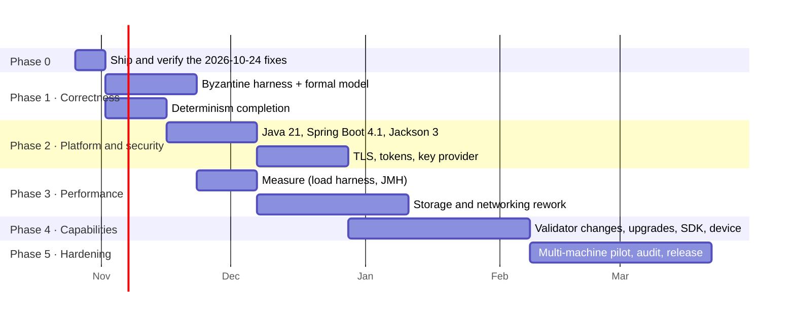

# HybridChain — Upgrade Plan

*Written 2026-10-24, after the fixes HC-087 to HC-093. Companion to
[`ARCHITECTURE_DEEP_DIVE.md`](ARCHITECTURE_DEEP_DIVE.md) (the rating),
[`GAP_ANALYSIS.md`](GAP_ANALYSIS.md) (missing capabilities) and
[`UPGRADE_AUDIT.md`](UPGRADE_AUDIT.md) (dependencies and code health).*

This plan takes every area of the scorecard from its current score to a target, with concrete
work items, how to know an item is done, effort, order and risk. Effort is in **developer-weeks
for one developer**, the current team size. Estimates assume the existing test discipline
(failing test first, one commit per item, full suite and a harness run before merging).

---

## 1. Where we start and where we go

| Area | Now | After the fixes of 2026-10-24 | Target | Main lever |
|---|---|---|---|---|
| Concept and scope | 8 | 8 | 9 | a real pilot use case, an SDK, a real device |
| Consensus correctness | 5 | **6.5** | 8.5 | Byzantine scenarios in the live harness, a full-protocol formal model, on-chain validator changes |
| Cryptography | 6.5 | **7** | 8.5 | post-quantum votes and handshake, a reviewed ZK proof, checksummed addresses |
| Security engineering | 6.5 | 6.5 | 8.5 | TLS for the API, asymmetric tokens, a key provider, an external audit |
| Determinism discipline | 6 | **7.5** | 9 | no floating point in state, golden roots everywhere, roots compared across platforms in CI |
| Code quality | 5 | 5.5 | 8 | split the God classes, delete the PoW and governance leftovers, inject configuration |
| Testing and verification | 7.5 | **8** | 9.5 | load, soak, crash and Byzantine scenarios; fuzzing; multi-machine |
| Performance and scalability | 3 | 3 | 7 | measure first, then incremental state storage, per-peer send queues, shorter blocks |
| Operability | 5 | **5.5** | 8 | dashboards and alerts, backup/restore, rolling upgrades |
| Documentation | 7.5 | 7.5 | 9 | OpenAPI, SDK docs, docs checked in CI |
| Production readiness | 3 | **3.5** | 7 | everything above, plus an audit and a multi-machine pilot |
| **Overall** | **5.5** | **≈ 6** | **≈ 8.5** | |

What the fixes of 2026-10-24 changed:

| ID | Fix | Score effect |
|---|---|---|
| HC-087 | validators vote only for the view's leader, once per (view, height) | consensus |
| HC-088 | automatic evidence is signed with both keys, so jailing works by default | consensus |
| HC-089 | one atomic write batch per block; an inconsistent store is refused at start-up | determinism, operability |
| HC-090 | state root v2 over a canonical binary encoding, with a golden test | determinism; unblocks Spring Boot 4 |
| HC-091 | domain-separated block signature that covers the proposer id | cryptography |
| HC-092 | unsafe "fast path" removed | consensus |
| HC-093 | revoked devices stay unmapped across restarts (a restarted node used to disagree) | determinism |

HC-090 and HC-091 change the block and state formats from height 0, so they apply to **new networks**.
The harness and test networks start from genesis, so nothing existing is affected.

---

## 2. Rules for every upgrade

These keep the project's strongest property, that every change is proven, while it grows.

1. **Failing test first.** The test is committed with the fix and fails on the code before it.
2. **One finding or one upgrade per commit**, named `HC-xxx: …` or `deps: …`.
3. **Consensus changes need an activation height** in `Config` (like `STATE_ROOT_V2_ACTIVATION_HEIGHT`). Keep the old rule for heights below it. A live network schedules the height (see `docs/design/PROTOCOL_UPGRADES.md`).
4. **The golden tests must not change.** `StateRootV2Test.GOLDEN` and any later golden value change only together with an activation height. A failing golden test after a library upgrade means **stop**: the upgrade would fork the network.
5. **Gate for merging to `main`:** CI green (tests and coverage floors) plus, for anything in consensus, networking or storage, a live harness run at 4 **and** 7 validators.
6. **No bot commits on `main`:** apply Dependabot updates as your own commits (see `.github/dependabot.yml`).

---

## 3. Phase overview

About **30 developer-weeks** in total: roughly 7 months for one developer, or about 4 months for two.
Phases 1 and 3 can run in parallel with a second person.

---

## 4. Phase 0 — ship and verify the fixes (1 week)

| # | Task | Done when |
|---|---|---|
| 0.1 | Push the fixes and let CI run | CI green on `main` |
| 0.2 | Live harness, all scenarios, 4 and 7 validators. First run with the new voting rules (HC-087), the hybrid evidence (HC-088), atomic storage (HC-089), state root v2 and the new block signature. | every phase PASS; equivocation jails with **automatic** evidence; the ±30 s clock-skew phases pass |
| 0.3 | Update `HYBRIDCHAIN_EXPLAINED.md` with the corrections in deep-dive section 19 | no stale statements left |
| 0.4 | Record the new numbers (tests, coverage) in the deep dive | |

**Risk:** HC-087 removes the 60-second re-proposal. A lost proposal is now replaced only by the
view change (135 s). If the delay/loss phases get slower, add **proposal re-broadcast** (task
1.4) before anything else.

---

## 5. Consensus correctness: 6.5 → 8.5

| # | Task | Details | Done when | Effort |
|---|---|---|---|---|
| 1.1 | **Byzantine proposer in the live harness** | A harness mode in which one validator runs a patched proposer: competing blocks for the same height, blocks for the wrong view, and blocks with invalid state roots. Add as `byzantine-proposer` in `run.sh`. | Safety holds; honest validators are **never** jailed; the Byzantine validator is jailed when it signs two blocks | 1.5 |
| 1.2 | **Double-voter in the live harness** | One validator signs conflicting PREPAREs/COMMITs on the wire, not just through submitted evidence | Automatic evidence (HC-088) jails it on every node; safety holds | 1 |
| 1.3 | **Full-protocol TLA+ model** | Extend `docs/formal/` from leader selection to votes, quorums, view change, NEW_VIEW with prepared proofs, jailing, and the new "one vote per (view, height)" rule. Model-check n = 4 and f = 1 Byzantine with TLC. | Invariants hold: agreement, no honest self-equivocation, a committed block is never replaced. The model must find HC-087 if the rule is removed. | 3 |
| 1.4 | **Proposal re-broadcast** | Re-send the **same** pending proposal (same hash) if it hasn't committed after `TARGET_BLOCK_TIME_MS`. Needs a gossip path that bypasses the local "already seen" cache. | Delay/loss phases at least as fast as before HC-087 | 0.5 |
| 1.5 | **Explicit view in vote messages** | Votes are verified against the receiver's local view, and the view isn't carried in the wire message. Carry it, and buffer votes for a future view instead of dropping them. | Fewer view-change stalls in the partition phase | 1 |
| 1.6 | **On-chain validator-set changes** (GAP C1) | A `VALIDATOR_UPDATE` transaction (add/remove, signed by a quorum of current validators), applied at `height + k` (epoch boundary), in the state root. `PBFTConsensus` and the handshake allow-list read the set from state. Delete the unwired `MultiSigManager`/`GovernanceManager` path. | Harness scenario: add a 5th validator, remove one, the chain keeps committing; quorum sizes follow | 3 |
| 1.7 | **Commit-certificate aggregation** (later) | BLS (or ML-DSA aggregation once standard) to shrink certificates from O(n) signatures | Certificate size constant in n | 2 |

---

## 6. Cryptography: 7 → 8.5

| # | Task | Details | Done when | Effort |
|---|---|---|---|---|
| 2.1 | **Post-quantum votes** | Hybrid votes: ECDSA plus ML-DSA over the same `HYBRIDCHAIN-PBFT-v3` digest, behind an activation height. Validator identities become `hq` addresses. ML-DSA signatures are about 3.3 KB, so this costs bandwidth: measure it in Phase 3. | Votes and certificates verify only with both signatures; harness green | 2 |
| 2.2 | **Post-quantum handshake** | Hybrid key exchange (X25519 + ML-KEM) for peer TLS, once the JDK/BouncyCastle TLS stack supports it, or an ML-KEM layer inside the handshake. Bind the handshake to the TLS session (channel binding). | Handshake transcript includes the TLS exporter value | 2 |
| 2.3 | **Fix the ownership proof** | The weaknesses already found: injective hashing of the transcript, reject `s ≥ N`, and constant-time scalar arithmetic instead of BigInteger double-and-add (about 3 s per proof today). Then an external cryptographer's review. | Malformed-proof test matrix; review report | 1.5 |
| 2.4 | **Checksummed addresses** | Bech32m encoding (`hb1…`, `hq1…`) for display and input, keeping the internal 20-byte id | A one-character typo is rejected | 0.5 |
| 2.5 | **Key provider** | Implement `docs/design/KEY_PROVIDER.md`: PKCS#11 (HSM / SoftHSM in tests) and file-plus-passphrase; remove keys from environment variables | Validator key never in env or logs; tests run with SoftHSM | 2 |

---

## 7. Security engineering: 6.5 → 8.5

| # | Task | Details | Done when | Effort |
|---|---|---|---|---|
| 3.1 | **TLS for the REST API** | Spring `server.ssl` with a configured key store, or a documented reverse proxy (Caddy/nginx), with HSTS; refuse plain HTTP outside DEBUG | Production profile refuses to start without TLS | 1 |
| 3.2 | **Asymmetric tokens** | Replace the shared HS256 `JWT_SECRET` with ES256/EdDSA tokens signed by the issuing node; peers verify with the node's public key. No node can mint tokens "as" another node. | `JWT_SECRET` removed; login (HC-085) issues ES256 tokens | 1 |
| 3.3 | **Rate limiting before authentication** | The API rate limiter is an MVC interceptor, after the security chain, so rejected floods aren't counted. Move it into a servlet filter ahead of Spring Security. | Unauthenticated floods are rate-limited per IP | 0.5 |
| 3.4 | **CA hardening** | Implement `docs/design/CA_TRUST_MODEL.md`: an offline root, per-node certificates issued once (not derived from a shared seed), expiry and a revocation list | `NETWORK_CA_SEED` removed; revoked certificate refused | 2 |
| 3.5 | **Configurable `MAX_CONN_PER_IP`** (GAP N2) | Needed behind NAT | Configurable, documented | 0.25 |
| 3.6 | **Threat model and external audit** | Written threat model (STRIDE per component), then an external audit of consensus, networking and crypto | Audit report; every finding resolved | 3 + audit |
| 3.7 | **Secret scanning in CI** | gitleaks on new commits only (history has known, rotated secrets) | CI fails on a new secret | 0.25 |

---

## 8. Determinism discipline: 7.5 → 9

| # | Task | Details | Done when | Effort |
|---|---|---|---|---|
| 4.1 | **No floating point in consensus state** | Account `reputation` (a `double` in every account's trie value) and the device `reputationScore` become fixed-point integers (as PBFT reputation did in Phase 1). Behind an activation height. | No `double`/`float` reachable from `calculateStateRoot` or any validity rule; an ArchUnit test enforces it | 1.5 |
| 4.2 | **Golden roots for every part** | Golden tests for the account encoding, transaction and block encodings, `txRoot`, receipts, and the state root after a scripted multi-block scenario | Any encoding change fails a golden test | 1 |
| 4.3 | **Cross-platform determinism in CI** | Run the scripted scenario on Linux, Windows and ARM64 (GitHub runners) and compare roots | Identical roots on all three | 0.5 |
| 4.4 | **Ban wall-clock and local state in validity** | An ArchUnit rule: no `System.currentTimeMillis`, `Random` or AI/monitoring class reachable from `validateTransaction`/`applyBlockInternal`, except the documented block-time and drift checks | Rule in the test suite | 0.5 |
| 4.5 | **Pin consensus-critical libraries** | BouncyCastle and Chicory upgrades only with a golden pass and a harness run (already in `dependabot.yml`); record the versions in the release notes | Process documented | 0.1 |

---

## 9. Code quality: 5.5 → 8

| # | Task | Details | Done when | Effort |
|---|---|---|---|---|
| 5.1 | **Split `Blockchain.java` (≈ 2,050 lines)** | `TransactionValidator` (per-type rules, one class per type family), `StateTransition` (`applyTransactionToState`), `BlockApplier` (the 20 steps of `applyBlockInternal`), `BlockBuilder` (`createBlock`), `ChainStore` (persistence, forks, init). `Blockchain` becomes a façade. | No class over 600 lines; behaviour unchanged (the full suite and the golden tests pass) | 3 |
| 5.2 | **Split `PeerNode.java` (≈ 1,330 lines)** | `PeerTransport` (TLS, handshake, framing, per-peer send queues), `GossipRouter`, `ConsensusMessaging` (PBFT messenger, `onProposal`), `ChainSync`, `CheckpointService`, `PeerDiscovery` | same | 2 |
| 5.3 | **Split `IoTRestAPI.java` (≈ 1,190 lines)** | One `@RestController` per resource (accounts, transactions, blocks, devices, AI, admin, auth). Do it during the Spring Boot 4 migration. | same | 1.5 |
| 5.4 | **Remove PoW leftovers** | `nonce`, `difficulty`, `Difficulty`, `Block.mine` out of the block header (header v2, activation height) | Header has no PoW fields | 0.5 |
| 5.5 | **Injected configuration** | Replace the remaining mutable statics (`BYPASS_CONTRACT_AUDIT`, `NODE_ID`) and `Config` lookups in core classes with a `NodeConfig` object passed in; tests construct their own | No mutable static in `Config` | 1.5 |
| 5.6 | **One shared `ObjectMapper`**, no swallowed exceptions | 26 `new ObjectMapper()` → one configured instance; 23 empty catches → logged or counted | SpotBugs clean for these patterns | 0.5 |
| 5.7 | **Coverage floors** | `api` ≥ 70 % lines, `PeerNode` ≥ 70 % lines (currently about 51 % and 47 %); raise the global floors | JaCoCo rules in the pom | 1.5 |

---

## 10. Testing and verification: 8 → 9.5

| # | Task | Details | Done when | Effort |
|---|---|---|---|---|
| 6.1 | **Load generator** | A harness tool that logs in (HC-085), funds N accounts and submits signed transfers, telemetry and contract calls at a target rate; reports TPS and latency percentiles | Repeatable numbers in `docs/benchmarks/` | 1.5 |
| 6.2 | **Soak run** | 24 h at a fixed load with periodic faults; checks memory, file handles, disk growth and liveness | No leak, no stall | 1 |
| 6.3 | **Crash injection** | `kill -9` a validator at random points during block persistence (many iterations); restart; safety and restart checks (HC-089 regression) | 100 crashes, 0 inconsistent stores | 0.5 |
| 6.4 | **Fuzzing** | Jazzer on the P2P message decoder, the handshake, transaction/block deserialisation, the VM and the WASM host functions | Running in the weekly CI job, no open crashes | 1.5 |
| 6.5 | **Multi-machine harness** (GAP N1) | The same `check.py` against 4 to 7 cloud VMs or Raspberry Pis across real networks | All scenarios PASS on real machines | 1.5 |
| 6.6 | **Mutation testing beyond `Crypto`** | PIT on `PBFTConsensus`, `CanonicalEncoding`, `Mempool` and the validation rules | Mutation score ≥ 75 % on those | 1 |

---

## 11. Performance and scalability: 3 → 7

**Measure before changing anything** (6.1 and JMH micro-benchmarks); every item below must
show its gain in numbers.

| # | Task | Details | Expected effect | Effort |
|---|---|---|---|---|
| 7.1 | **Incremental state storage** | Today the whole state is rewritten as one JSON blob per block. Store trie nodes by hash (as Ethereum does) and write only the changed nodes; the snapshot becomes a root pointer. | Block persistence cost O(changes) instead of O(state) | 3 |
| 7.2 | **RocksDB** (UPGRADE_AUDIT U4) | Replace LevelDB JNI 1.8 (2013, no ARM64 build); keep the batch API from HC-089 | Faster writes, ARM64-native | 1 |
| 7.3 | **Per-peer send queues** | `PeerNode.sendMessage` is one global `synchronized` lock: a slow peer blocks all sends. One bounded queue and writer per peer. | No head-of-line blocking | 1 |
| 7.4 | **Virtual threads** (needs Java 21) | Replace the cached thread pool for connections | Thousands of connections cheaply | 0.25 |
| 7.5 | **Parallel signature verification** | Verify transaction signatures of a block in parallel before sequential execution; cache verified txids from mempool admission | Block validation time ÷ cores | 1 |
| 7.6 | **Shorter block time** | Make `TARGET_BLOCK_TIME_MS` a protocol parameter changed by activation height (not by the removed admin endpoint); target 2–5 s, with the view timeout derived from it | Finality in seconds instead of minutes | 0.5 (+ tuning) |
| 7.7 | **Real gas** | The fee market counts **transactions** as gas; charge by bytes and execution | Fair fees, spam resistance | 1 |

**Targets** (4 validators, LAN, after 7.1–7.6): ≥ 500 transfers/s sustained, finality under 5 s, and
no more than 2× degradation at 7 validators. These are goals to verify, not promises.

---

## 12. Operability: 5.5 → 8

| # | Task | Details | Done when | Effort |
|---|---|---|---|---|
| 8.1 | **Dashboards and alerts** | Grafana dashboard plus Prometheus alert rules: height stall, view-change rate, clock drift (from `/health` `time`), peer count, jailed validators, mempool size, disk | Shipped in `ops/`; alert fires in a harness fault | 1 |
| 8.2 | **Backup and restore** | Export/import of a quorum-signed checkpoint plus its snapshot; a documented restore procedure, tested | Restore on an empty node syncs and matches roots | 1 |
| 8.3 | **Rolling upgrades** | A harness scenario that upgrades validators one at a time across an activation height | Chain keeps committing through the upgrade | 1.5 |
| 8.4 | **Config validation at start-up** | Refuse unknown or contradictory settings with a clear message (one place) | Bad config → exit with the reason | 0.5 |
| 8.5 | **Multi-host deployment kit** | Compose or Helm for validators on several hosts, with TLS, volumes, and a key provider | A new 4-node network on 4 hosts in under an hour | 1.5 |
| 8.6 | **Fix `PRODUCTION_CHECKLIST.md`** | It points Prometheus at `/actuator/prometheus`, which isn't exposed; the metrics are at `/api/v1/metrics` | Checklist matches reality | 0.1 |

---

## 13. Platform upgrades (Phase 2)

| # | Upgrade | Why now | Steps | Effort |
|---|---|---|---|---|
| P.1 | **Java 21** (or 25) | Java 17 premier support ended September 2026; virtual threads | `maven.compiler.release=21`, CI `java-version: 21`, Docker `eclipse-temurin:21-jre`, all three in **one** commit; full suite and harness | 0.5 |
| P.2 | **Spring Boot 4.1** | 3.5 is out of free support (June 2026); Dependabot PR #4 is waiting | Branch; follow the 4.0/4.1 migration guides; fix moved test packages (`…test.autoconfigure.web.servlet`); Spring Security 7 configuration; Tomcat 11 comes with it | 2 |
| P.3 | **Jackson 3** (with Boot 4) | Boot 4's default | Safe for consensus since HC-090. **Check:** `StateRootV2Test.GOLDEN` must stay green. The P2P wire format and storage use Jackson too: run a mixed-version harness (old and new nodes) before switching a live network. | inside P.2 |
| P.4 | **MQTT 5 client, DTLS for CoAP** | Paho v3 is in low maintenance; telemetry needs transport security | HiveMQ or Paho v5 client; Californium Scandium for DTLS with device PSK or certificates | 2 |

---

## 14. Capabilities for real deployments (Phase 4)

| # | Capability | Details | Effort |
|---|---|---|---|
| 9.1 | **Client SDK** (GAP A1) | TypeScript and Python: keys (including `hq`), signing, login, submit, receipts, WebSocket events; the `ABIEncoder`/`ABIDecoder` logic moves here | 3 |
| 9.2 | **OpenAPI** | Generated from the controllers after 5.3 | 0.5 |
| 9.3 | **A real device** (GAP I1) | Raspberry Pi or ESP32 signing `DeviceReading`s over MQTT/CoAP to a gateway; the measured `EdgeReadinessProbe` replaces the estimates | 1.5 |
| 9.4 | **Device onboarding runbook** | Manufacturer key → provisioning → activation with consent → first reading, end to end | 0.5 |
| 9.5 | **Data protection** | Keep personal data off-chain (commitments only); a GDPR note | 0.5 |

---

## 15. Production readiness (Phase 5)

1. **Multi-machine pilot:** 4 to 7 validators on separate machines, run by at least two operators, for 30 days, with the load generator at pilot load.
2. **External security audit** of consensus, networking, cryptography and storage (task 3.6); fix everything before the pilot holds anything of value.
3. **Release process:** semantic versions, signed release artifacts, SBOM attached (CycloneDX is already in CI), release notes listing activation heights and consensus-critical library versions.
4. **Service objectives and runbooks:** finality time, availability, incident response, key compromise (extends `docs/KEY_ROTATION.md`).

Production readiness reaches about 7 when items 1–4 are done. It goes beyond that only with an
operating history.

---

## 16. Order of work, in short

1. **Phase 0:** push, live harness with the new rules, update the explainer.
2. **1.4** proposal re-broadcast, if Phase 0 shows slower liveness.
3. **1.1, 1.2** Byzantine scenarios in the harness, and **4.1–4.4** determinism completion.
4. **P.1** Java 21, then **P.2/P.3** Spring Boot 4.1 with Jackson 3, guarded by the golden tests.
5. **3.1–3.5** TLS, asymmetric tokens, rate limiting, CA, per-IP limit.
6. **6.1** load generator, then **7.1–7.6** performance work, measured.
7. **5.1–5.3** split the large classes (alongside P.2 for the REST layer).
8. **1.6** on-chain validator changes, **8.3** rolling upgrades, **9.1–9.3** SDK and device.
9. **1.3** full formal model, **2.1–2.3** post-quantum votes and handshake, ZK review.
10. **Phase 5:** multi-machine pilot, audit, releases.
